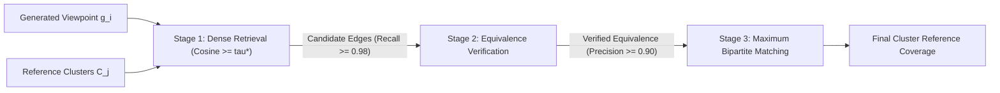

# Evaluator Validation: Mathematical Framework & Cross-Encoder Audit

**Phase 1 Deliverable**  
**Repository:** `perspective_coverage`

---

## 1. Audit of the Existing DeBERTa Cross-Encoder

### 1.1 The Training Formulation Bug
The fine-tuned checkpoint (`models/argument_nli_deberta_v3`) was trained via `src/training/prepare_multidataset_nli_data.py`. Inspection reveals the pair-generation logic:
```python
# ENTAILMENT: Match with human perspective of SAME stance
matching_humans = human_sups if "sup" in ai_stance else human_unds
for htxt in matching_humans[:2]:
  entail_pairs.append({
      "text_a": htxt,
      "text_b": ai_text[:600],
      "label": "entailment",
      "label_id": 1,
  })

# CONTRADICTION: Match with human perspective of OPPOSITE stance
opp_humans = human_unds if "sup" in ai_stance else human_sups
for htxt in opp_humans[:2]:
  contra_pairs.append({
      "text_a": htxt,
      "text_b": ai_text[:600],
      "label": "contradiction",
      "label_id": 0,
  })
```

### 1.2 Scientific Consequence
1. **Entailment Mislabeling:** Two completely different arguments that both happen to support a claim (e.g. *"Universal healthcare reduces bankruptcies"* and *"Universal healthcare improves preventive cancer screening"*) were labeled as **entailment**.
2. **Contradiction Mislabeling:** Arguments with opposite stances were labeled as **contradiction**, even if their factual assertions were completely orthogonal.
3. **Model Nature:** The resulting DeBERTa model learned **stance concordance** (whether two texts share the same polarity relative to an implicit claim), **NOT perspective equivalence** (whether two texts express the same underlying reasoning).
4. **Impact on Paper Draft:** When `evaluate_finetuned_two_stage.py` applied this model to dense candidate matches, candidates were accepted if $p_{\text{entail}} \ge 0.80$. In reality, $p_{\text{entail}} \ge 0.80$ merely verified that the LLM generation shared the same stance as the human perspective. This explains the high "two-stage coverage" numbers reported in the paper.

---

## 2. Decoupled Two-Stage Evaluator Framework

To eliminate this flaw, the evaluator must be split into two formally distinct stages:



### 2.1 Stage 1: Candidate Retrieval Calibration
Dense bi-encoders (such as `BAAI/bge-large-en-v1.5`) compress entire propositions into a single dense vector. While computationally efficient ($O(K \times M)$ dot products), dense embeddings cannot reliably distinguish subtle argumentative boundaries or nuanced opposites.

**Calibration Rule:**
Stage 1 functions strictly as a high-recall candidate filter. It must not discard genuine human matches:
$$\tau^* = \max \tau \quad \text{subject to} \quad \text{CandidateRecall}(\tau) \ge 0.98$$
Where:
$$\text{CandidateRecall}(\tau) = \frac{|\{(g_i, p_j) \in \mathcal{E}_{\text{true}} : \cos(\mathbf{e}_{g_i}, \mathbf{e}_{p_j}) \ge \tau\}|}{|\mathcal{E}_{\text{true}}|}$$

### 2.2 Stage 2: Cross-Encoder Perspective Verification
For candidate pairs passing Stage 1, a cross-encoder model evaluates token-level cross-attention:
$$\mathcal{M}_{\text{equiv}}(g_i, p_j) \to p_{\text{equiv}} \in [0, 1]$$

**Verification Rule:**
Choose operating threshold $\theta^*$ to maximize recall under high precision:
$$\theta^* = \arg\max_\theta \text{Recall}(\theta) \quad \text{subject to} \quad \text{Precision}(\theta) \ge 0.90$$

---

## 3. Stage 3: Maximum Bipartite Matching on Equivalence Clusters

### 3.1 The Greedy-Max Fallacy
Existing code in `src/analysis/coverage_score.py` computed coverage via:
$$\hat{s}_j = \max_i S_{i, j}, \quad \text{Covered}_j = \mathbb{I}(\hat{s}_j \ge \tau)$$
This formulation allows a single generated argument $g_1$ to match 10 different reference perspectives simultaneously, artificially inflating coverage for redundant generations.

### 3.2 Maximum Bipartite Graph Matching Formulation
Let $\mathcal{G} = (\mathcal{V}_{\text{gen}}, \mathcal{V}_{\text{ref}}, \mathcal{E})$ be a bipartite graph where:
- $\mathcal{V}_{\text{gen}} = \{g_1, \dots, g_K\}$ are the $K$ distinct viewpoints generated by the LLM for a claim.
- $\mathcal{V}_{\text{ref}} = \{C_1, \dots, C_M\}$ are the $M$ ground-truth equivalence clusters for the claim.
- An edge $(g_i, C_j) \in \mathcal{E}$ exists if and only if $g_i$ is verified as equivalent to at least one paraphrase $p \in C_j$ under Stages 1 and 2.

We find the maximum cardinality matching $\mathcal{M}^* \subseteq \mathcal{E}$ such that no two edges share a common vertex:
$$\max |\mathcal{M}^*| \quad \text{subject to} \quad \forall v \in \mathcal{V}_{\text{gen}} \cup \mathcal{V}_{\text{ref}}, \ \text{deg}_{\mathcal{M}^*}(v) \le 1$$

Solved via the Kuhn-Munkres / Hopcroft-Karp algorithm (`scipy.optimize.linear_sum_assignment`).

**Final Metric (Cluster Reference Coverage):**
$$\text{Coverage}(\mathcal{C}) = \frac{|\mathcal{M}^*|}{M}$$
This guarantees:
1. One generated viewpoint can cover at most one reference perspective cluster.
2. Multiple generated paraphrases of the same idea cannot be credited multiple times.
3. The denominator is the true number of distinct perspectives, not the count of crowd-worker paraphrases.

