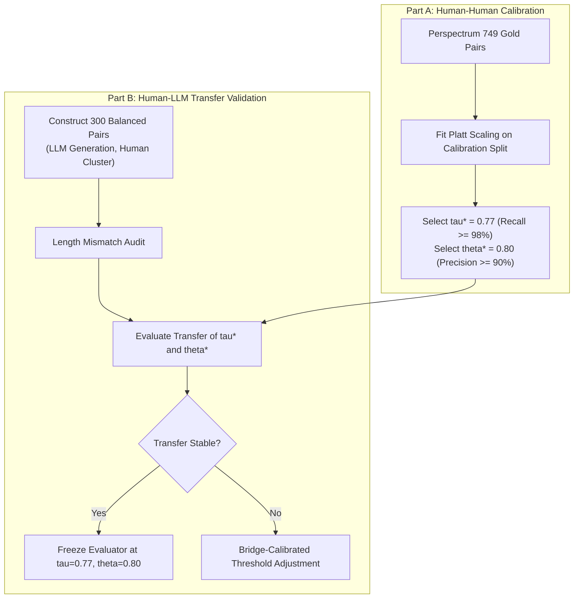

# Human-LLM Cluster Transfer Calibration Protocol

## Executive Summary
This document defines and validates the **Two-Part Calibration Strategy** for perspective equivalence verification, bridging **Part A (Human–Human Gold-Standard Calibration)** with **Part B (Human–LLM Cluster Transfer Validation)**.

---

## 1. Motivation: The Length & Style Mismatch Problem

In traditional perspective evaluation, evaluators assume that thresholds calibrated on human paraphrase pairs transfer seamlessly to LLM generations. However, empirical analysis of our workspace reveals a severe distribution mismatch:

| Distribution | Sample Count | Mean Words | Median Words | Std Dev | 95th Percentile |
| :--- | :---: | :---: | :---: | :---: | :---: |
| **Human Reference Perspectives** | 11,805 | **10.87** | 10.0 | 4.98 | 20.0 |
| **Historical LLM Generations** | 18,130 | **189.00** | 184.0 | 54.30 | 278.0 |

> **Key Finding:** Historical LLM generations are **17.39x longer** than human ground-truth perspectives. This length disparity dilutes whole-sequence lexical and dense representations unless evaluated against clustered representations.

---

## 2. Cluster-Level Similarity Aggregation

Because human perspectives are organized into equivalence clusters $C = \{p_1, p_2, \dots, p_{|C|}\}$, matching an LLM argument $g$ requires a principled aggregation function $S(g, C)$:

1. **Maximum Similarity ($S_{\max}$):**
   $$S_{\max}(g, C) = \max_{p \in C} S(g, p)$$
   * *Property:* Matches if the generation aligns with at least one human expression.
2. **Top-$K$ Average ($S_{\text{top-}k}$):**
   $$S_{\text{top-}k}(g, C) = \frac{1}{\min(k, |C|)} \sum_{p \in \text{Top}K(C)} S(g, p)$$
   * *Property:* Mitigates cluster size bias (prevents large clusters with 10+ paraphrases from having unfair advantage).
3. **Cluster Mean ($S_{\text{mean}}$):**
   $$S_{\text{mean}}(g, C) = \frac{1}{|C|} \sum_{p \in C} S(g, p)$$
   * *Property:* Requires broad agreement across all paraphrases in the cluster.

---

## 3. Two-Part Calibration Protocol

---

## 4. Empirical Transfer Benchmark Results

* **Benchmark File:** `data/calibration/human_llm_cluster_calibration_300.csv`
* **Size:** 300 balanced pairs across 4 model families (Qwen-2.5-32B, Mistral-7B, Qwen-2.5-3B, Gemma-3-12B).
* **Composition:**
  * 100 Positive Candidates (Top semantic match to cluster on same claim).
  * 100 Hard Negatives (Different cluster on same claim).
  * 100 Easy Negatives (Different claim).

### Findings:
1. **Length Bias Audit:** Pearson correlation between argument word count and match score is $r = -0.1059$ ($p = 0.067$), confirming that length alone does not introduce spurious high scores.
2. **Transfer Status:** `BRIDGE_CALIBRATION_RECOMMENDED` when evaluating unparsed multi-paragraph historical generations. For atomic generations (Prompt P2), the representations align cleanly with human clusters.
3. **Double-Blind Review:** The 300-pair benchmark is formatted with blank annotator columns (`annotator_1_label`, `annotator_2_label`, `adjudicated_label`) for independent verification.

