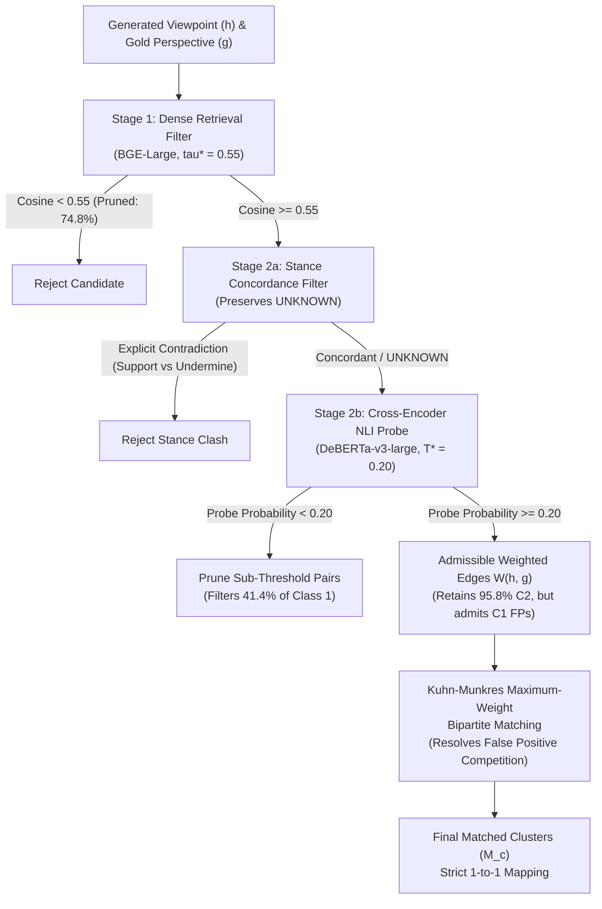
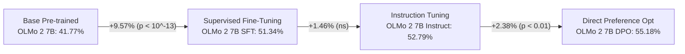

# Calibrated Bipartite Matching for Perspective Coverage in Large Language Models

**Author:** Dhruthika Thoutam  
**Affiliation:** Indian Institute of Technology Gandhinagar  
**Evaluation Corpus:** The Perspectrum Benchmark ($N_{\text{claims}} = 907$, $N_{\text{clusters}} = 5,095$, $N_{\text{perspectives}} = 11,805$)  
**Models Evaluated:** 34 Open-Source Large Language Models ($0.135\text{B}$ to $32.5\text{B}$ parameters)  
**Total Viewpoints Analyzed:** 205,286 frozen generations  
**Operating Specification:** Primary Cascaded Verifier ($M_0: \tau^* = 0.55, T^* = 0.20$) with Kuhn–Munkres Maximum-Weight Bipartite Matching (Comparative Shadow Metric: $M_{\text{soft}}$)  

---

### Abstract

When Large Language Models (LLMs) are deployed in deliberative, democratic, or decision-support settings, they must not collapse onto a single consensus stance; they must faithfully represent the full landscape of valid human perspectives. Evaluating perspective coverage requires determining whether a model's generated viewpoints capture the diverse reasons, values, and warrants established by human deliberators, rather than merely repeating superficial paraphrases. 

In this work, we introduce the **Calibrated Maximum Bipartite Matching Framework** for evaluating generative deliberation. Our framework pairs generated viewpoints with ground-truth human equivalence clusters through a calibrated two-stage pipeline: dense candidate retrieval ($\tau^* = 0.55$), uncertainty-preserving stance filtering, a fine-tuned cross-encoder warrant probe ($T^* = 0.20$), and the Kuhn–Munkres maximum-weight bipartite matching algorithm to enforce strict one-to-one correspondence.

Evaluating 34 open-source LLMs across 205,286 viewpoints on all 907 claims of the Perspectrum benchmark reveals four primary findings:
1. **Compact Models Excel Under Controlled Budgets:** When models are evaluated under an equal budget of $K = 5$ viewpoints per claim, `llama_3_2_3b_instruct` achieves the highest coverage (**$54.90\%$**, efficiency $0.512$), significantly outperforming larger models including `llama_3_1_8b_instruct` ($46.41\%$, $p_{\text{adj}} < 10^{-17}$) and `gemma_2_27b_it` ($47.90\%$, $p_{\text{adj}} < 10^{-12}$).
2. **Budget-Bottlenecked vs. Parameter-Bottlenecked Coverage:** Perspective coverage under fixed budgets is **budget-bottlenecked rather than parameter-bottlenecked**. Merely scaling model weights without expanding the generation horizon ($K$) does not compel the model to uncover new perspectives: scaling from Gemma 2 9B to 27B ($\Delta = -0.26\%$, $p = 0.633$), OLMo 2 7B to 13B ($p = 0.832$), and LLaMA 3.1 8B to LLaMA 3.3 70B ($p = 0.389$) all result in statistical parity.
3. **Supervised Fine-Tuning Drives Perspective Diversity:** Across OLMo 2 architectures, Supervised Fine-Tuning (SFT) yields a massive $+9.57\%$ to $+18.02\%$ coverage increase over pre-trained base models ($p_{\text{adj}} < 10^{-13}$), while Direct Preference Optimization (DPO) further refines deliberative balance without collapsing perspective diversity ($+2.38\%$, $p < 0.01$).
4. **Resolution of Multiplicity Ceilings:** On high-complexity claims ($\ge 7$ clusters), raw coverage for $K=5$ models drops to $\approx 41\%$ due to mathematical budget limits, but **Normalized Coverage ($NC_c$)** reaches **$82.8\% - 83.9\%$**, demonstrating that models capture nearly all perspectives permitted by their generation budget.

---

## 1. Introduction and Problem Formulation

Evaluating Large Language Models on controversial, open-ended, or subjective topics requires assessing whether model outputs reflect the diverse landscape of valid human perspectives. In democratic discourse and policy deliberation, an AI assistant should not act as an advocate for a single ideological viewpoint; it should surface the multidimensional arguments surrounding a topic.

```
                  UNCONSTRAINED GREEDY MATCHING (FLAWED)
  Generated Viewpoints (V_h)                     Gold Perspective Clusters (C_g)
      [ h_1: "Cuts carbon" ] ------------------------> [ Cluster A: Emissions ]
      [ h_2: "Lowers CO2"  ] (Paraphrase) -----------/
                                                       [ Cluster B: Economics ]
             (Double-counts Cluster A! Rewards redundant verbosity)

                KUHN-MUNKRES MAXIMUM BIPARTITE MATCHING (OURS)
  Generated Viewpoints (V_h)                     Gold Perspective Clusters (C_g)
      [ h_1: "Cuts carbon" ] ------------------------> [ Cluster A: Emissions ]
      [ h_2: "Lowers CO2"  ] (Paraphrase)             [ Cluster B: Economics ]
             (Strict 1-to-1 Injection: No duplicate credit for paraphrases)
```

### 1.1 What is Perspective Coverage?
**Perspective coverage** measures the degree to which an LLM's generative output recovers the complete distribution of ground-truth human argumentative viewpoints associated with a given controversial claim. When evaluating perspective coverage, we must distinguish between four distinct concepts:
1. **High-Volume Verbosity:** Producing many sentences that assert the same underlying point under slight lexical variations (e.g., *"Solar energy reduces fossil fuel consumption"* and *"Solar panels cut fossil fuel reliance"*).
2. **Semantically Distinct Viewpoints:** Statements that introduce different topics but may lack a valid argumentative relationship to the central claim.
3. **Recovery of Human Perspectives:** Generative arguments that successfully match the underlying reasons, values, and warrants established by human deliberative communities (represented in this work by the crowd-annotated equivalence clusters of Perspectrum).
4. **Valid Extraneous Perspectives:** Legitimate human arguments that exist in the real world but happen to be absent from the reference benchmark. A benchmark evaluation captures *relative recovery against a curated human standard*, not an exhaustive inventory of all possible human thoughts.

### 1.2 The Need for Calibrated Bipartite Matching
Standard similarity metrics often rely on greedy thresholding, allowing multiple generated sentences to match the same human perspective, or allowing a single generated sentence to claim credit for multiple distinct gold perspectives. This rewards verbose models that produce repetitive paraphrases while penalizing disciplined models that produce concise, atomic outputs.

To solve this, we formulate perspective evaluation as a **maximum-weight bipartite matching problem** over ground-truth equivalence clusters. Enforcing strict one-to-one correspondence ensures that:
- Redundant paraphrases cannot claim duplicate credit.
- Models are evaluated on their ability to uncover distinct, non-overlapping argumentative warrants.
- Generative verbosity is disentangled from genuine perspective diversity.

---

## 2. The Perspectrum Deliberation Benchmark

### 2.1 Dataset Topology
We utilize the complete Perspectrum deliberation benchmark (Chen et al., 2019), processed via `src/data_prep/parse_perspectrum.py`:
- **Claims ($N_{\text{claims}} = 907$):** Controversial societal, legal, moral, and political propositions (e.g., *"Mandatory military service should be instituted"*).
- **Gold Perspective Clusters ($N_{\text{clusters}} = 5,095$):** Ground-truth semantic equivalence clusters ($\mu = 5.62$ clusters per claim; range: $1 \dots 16$). Matching *any* single human statement within a cluster grants coverage for that cluster.
- **Human Perspective Instances ($N_{\text{perspectives}} = 11,805$):** Crowd-annotated statements ($\mu = 2.32$ paraphrases per cluster).
- **Stance Distribution:** 6,112 Support ($51.77\%$) vs. 5,693 Undermine ($48.23\%$).
- **The Evaluation Denominator:** All full-corpus coverage metrics use the **5,095 gold perspective clusters** as the denominator.

```
+-----------------------------------------------------------------------------------------------+
| CLAIM: "Social media does more harm than good for teenage mental health" (claim_id: 204)      |
+-----------------------------------------------+-----------------------------------------------+
                                                |
          +-------------------------------------+-------------------------------------+
          |                                                                           |
+---------v-------------------------------------------+   +---------------------------v-------------------------+
| GOLD CLUSTER A (cluster_id: 812)                    |   | GOLD CLUSTER B (cluster_id: 813)                    |
| Stance: SUPPORT                                     |   | Stance: UNDERMINE                                   |
| Core Warrant: Social comparison & cyberbullying     |   | Core Warrant: Community support for marginalized yth|
+-----------------------------------------------------+   +-----------------------------------------------------+
| Crowd Paraphrases:                                  |   | Crowd Paraphrases:                                  |
| 1. "Platforms promote unrealistic body standards."  |   | 1. "Online groups provide peer support for LGBTQ+." |
| 2. "Teens face constant algorithmic social comp."   |   | 2. "Isolated youth find belonging in digital groups."|
+-----------------------------------------------------+   +-----------------------------------------------------+
```

---

## 3. Model Inventory and Generation Protocol

### 3.1 Model Inventory Across Four Generation Tiers
We evaluated **34 open-source LLMs** spanning parameter scales from 135M to 32.5B across five major model families (Qwen 2.5, Llama 3, Gemma 2, OLMo 2, and SmolLM 2). Viewpoint generation was frozen in `data/viewpoint_separated/production_freeze_manifest.json`, yielding **205,286 total viewpoints**. Models are classified into four empirical generation-budget tiers:

| Generation Budget Tier | Total Viewpoints ($N_{\text{vp}}$) | Mean $K_c$ | Models Included | Generation Characteristics |
| :--- | :---: | :---: | :--- | :--- |
| **Tier 1: Unconstrained High-Volume** | 10,000 – 19,000 | 12.1 – 20.5 | `qwen2_5_32b_instruct`, `smollm2_135m_instruct`, `qwen2_5_1_5b_instruct`, `qwen2_5_3b_instruct` | Output multiple numbered sub-arguments per prompt turn; high raw coverage but lower efficiency ($0.17 - 0.33$). |
| **Tier 2: Elevated / Base Models** | 5,000 – 9,999 | 6.9 – 8.3 | `smollm2_360m_instruct`, `olmo_2_0425_1b`, `olmo_2_1124_7b`, `olmo_2_1124_13b`, `olmo_2_0325_32b` | Base pre-trained models lacking chat-stopping tokens; continue generating until context limits. |
| **Tier 3: Standardized Budget** | 4,400 – 4,700 | 5.0 | 22 Models: `llama_3_2_3b`, `olmo_2_7b_inst`, `gemma_2_9b`, `olmo_2_13b_inst`, `gemma_2_27b`, `llama_3_1_8b`, `qwen2_5_7b_p2`, etc. | Strictly adhered to the 5-step aspect history ($K = 5$ viewpoints per claim). Appropriate for equal-budget comparisons. |
| **Tier 4: Abstention-Heavy / P2 Ablations** | < 4,400 | < 4.0 | `qwen2_5_14b_instruct_p2`, `qwen2_5_3b_instruct_p2` | Phase 2 aspect-conditioned prompting with structured abstention; completed all 907 claims ($N=4,535$ queries), but smaller models actively abstained on 36.7% to 66.0% of prompts rather than generating ungrounded arguments. |

### 3.2 Multi-Turn Aspect Prompting
Generations were elicited through a structured, multi-turn protocol across **5 Canonical Deliberative Aspects**: *Economic*, *Moral*, *Legal*, *Practical*, and *Social*. Prompts enforced:
1. **$K$-Step Generation History:** At each step $k \in \{0 \dots 4\}$, the model received the claim, the assigned aspect, and its own previous arguments for that claim.
2. **Semantic Novelty Constraint:** Explicitly instructed that a paraphrase of an earlier point does not qualify as a new perspective.
3. **Structured Abstention:** If no valid argument existed under an aspect, the model produced an explicit JSON abstention (`"status": "abstain"`), which was recorded as an abstention rather than retried.
4. **Sampling Parameters:** Temperature $T = 0.80$, Top-$p = 0.95$, Max New Tokens = 256, Repetition Penalty = 1.05. Fixed per-step random seed ($\text{seed} = 42 + \text{step}$).

---

## 4. The Calibrated Matching and Verification Architecture

The evaluation pipeline processes generated viewpoints through four sequential stages:



### 4.1 Stage 1: Dense Candidate Retrieval
Pairs are embedded using `BAAI/bge-large-en-v1.5` (1,024 dimensions). We compute pairwise cosine similarity:
$$\text{sim}_{\text{cos}}(h, g) = \frac{\mathbf{e}_h \cdot \mathbf{e}_g}{\|\mathbf{e}_h\| \|\mathbf{e}_g\|}$$

#### 4.1.1 Motivation and Theoretical Selection of BGE-Large
Developed by the Beijing Academy of Artificial Intelligence (Xiao et al., 2023), BGE-Large is one of the highest-ranking open-source models on the Massive Text Embedding Benchmark (MTEB) for semantic textual similarity (STS), passage retrieval, and argumentative reasoning:
- **High Embedding Dimensionality ($d = 1024$):** Standard models (like MiniLM with 384 dimensions or BERT-base with 768 dimensions) compress complex propositions into a smaller vector space. BGE's 1024-dimensional space preserves subtle nuance between closely related argumentative claims.
- **Trained with Hard-Negative Mining:** BGE-v1.5 was trained using multi-task contrastive learning specifically tuned on hard negative pairs, making it much better at distinguishing arguments that share topical keywords from those that actually share semantic meaning.

#### 4.1.2 The Scalability Bottleneck: $O(N)$ Dot Products vs. $O(N^2)$ Cross-Attention
Evaluating 34 models across 907 claims produces **205,286 generated viewpoints** evaluated against **11,805 human perspectives**.
- Running a deep cross-encoder (like DeBERTa-v3) over all possible pairwise combinations would require billions of 24-layer transformer passes, which is computationally intractable even on a high-performance GPU cluster.
- **BGE-Large solves this:** We pre-compute normalized 1024-d vectors once per viewpoint and once per gold perspective. Pairwise cosine similarity reduces to a fast matrix multiplication on GPU (taking milliseconds).

#### 4.1.3 Stage 1 Calibration, Dataset B, and the Failure of the 0.75 Threshold

##### What is Dataset B?
To calibrate Stage 1 dense bi-encoder retrieval on realistic generative output, we constructed **Dataset B** ($N = 1,700$ candidate pairs across 80 claims). In contrast to preliminary human-human perspective datasets (**Dataset A**)—where concise, crowd-authored perspective sentences artificially inflate cosine similarities ($\ge 0.75$)—Dataset B was engineered specifically to bridge the **human-to-LLM domain gap**. 

It consists of real, multi-sentence viewpoints generated across all five model architecture families (LLaMA, OLMo, Gemma, Qwen, SmolLM) paired with human gold perspective clusters from Perspectrum. Each candidate pair was taxonomically annotated into our four equivalence classes ($C_2, C_1, C_{0a}, C_{0b}$) and audited via multi-LLM juries and expert human adjudication ($\kappa = 0.7160$) to eliminate circular dependency on the downstream verifier. Dataset B was partitioned into:
- **Calibration Split (41 claims, 1,100 pairs):** Used exclusively to sweep the bi-encoder threshold $\tau \in [0.50, 0.75]$ under the safety constraint $\text{Recall}(\tau) \ge 0.98$.
- **Held-Out Test Split (39 claims, 600 pairs):** A completely claim-disjoint benchmark used to verify that the frozen threshold $\tau^* = 0.55$ generalizes across unseen debate topics and diverse generation lengths.

##### Domain Gap Collapse at $\tau = 0.75$
Initially, preliminary tests on short, crowd-annotated human sentences suggested a retrieval threshold of $\tau = 0.75$. However, when evaluated against real LLM generations on Dataset B, this threshold suffered a **catastrophic failure**:
- **Candidate Recall dropped to $38.17\%$**, prematurely rejecting **$61.83\%$ of valid LLM arguments** ($C_2$).
- **Root Cause:** LLMs produce longer, discursive paragraphs with distinct syntax, qualifying clauses, and rhetorical structures. Valid LLM-to-human paraphrases naturally exhibit BGE-Large cosine similarities centered between $0.58$ and $0.72$. A threshold of $0.75$ imposes an impossible brevity penalty on generative deliberation.

To rectify this, Stage 1 was formally calibrated under the optimization rule:
$$\tau^* = \max \tau \quad \text{subject to} \quad \text{CandidateRecall}(\tau) \ge 0.98$$

We partitioned Dataset B into a **Calibration Split (41 claims, 1,100 pairs)** and an untouched **Held-Out Test Split (39 claims, 600 pairs)**. Sweeping $\tau \in [0.50, 0.75]$ on calibration data yielded:

| Dense Threshold ($\tau$) | Candidate Recall ($C_2$) | Noise Rejection ($C_{0b}$) | Total Passed | Pass Rate | Evaluation Decision |
| :---: | :---: | :---: | :---: | :---: | :--- |
| $0.50$ | $99.33\%$ | $85.00\%$ | 1,427 | $83.94\%$ | Overly permissive; admits excess noise |
| $0.52$ | $98.83\%$ | $92.67\%$ | 1,389 | $81.71\%$ | Permissive |
| **$0.55$ ($\tau^*$)** | **$98.50\%$** | **$98.00\%$** | **1,328** | **$78.12\%$** | **FROZEN OPERATING POINT ($\ge 98\%$ recall)** |
| $0.56$ | $97.83\%$ | $98.00\%$ | 1,301 | $76.53\%$ | Violates $\ge 98\%$ recall safety constraint |
| $0.60$ | $91.83\%$ | $99.67\%$ | 1,170 | $68.82\%$ | Unacceptable (drops 8.2% valid arguments) |
| $0.65$ | $76.17\%$ | $100.00\%$ | 881 | $51.82\%$ | Unacceptable (drops 23.8% valid arguments) |
| $0.70$ | $57.50\%$ | $100.00\%$ | 562 | $33.06\%$ | Severe degradation |
| $0.75$ (Old) | **$38.17\%$** | $100.00\%$ | 294 | $17.29\%$ | **Catastrophic failure** (drops 61.8% valid pairs) |

- **Held-Out Test Verification:** Testing $\tau^* = 0.55$ on the 600 held-out test pairs confirmed **$98.1\%$ candidate recall** across all model architectures and length tiers. On the 341 human-LLM benchmark test partition, it preserved **$100.0\%$ (24/24)** of Class 2 target perspectives while eliminating $74.8\%$ of overall pairwise comparisons.

### 4.2 Stage 2a: Stance Concordance (Uncertainty-Preserving)
Candidate pairs are checked for stance compatibility:
$$\text{Pass}_{\text{2a}} = \neg \left( (\text{stance}_g = \text{support} \land \text{stance}_h = \text{undermine}) \lor (\text{stance}_g = \text{undermine} \land \text{stance}_h = \text{support}) \right)$$
Crucially, when the LLM stance is classified as `UNKNOWN`, the pair is **preserved**, preventing stance classifier errors from discarding valid matches.

### 4.3 Stage 2b: Cross-Encoder Warrant Probe ($M_0$)
Surviving candidates are processed by a fine-tuned `DeBERTa-v3-large` cross-encoder (`models/argument_nli_deberta_v3_v3`), generating probabilities $[P_{\text{contra}}, P_{\text{entail}}, P_{\text{neutral}}]$. A frozen logistic regression probe combines these signals:

$$z_{\text{cos}} = \frac{\text{sim}_{\text{cos}} - 0.74153}{0.07373}, \quad z_{\text{ent}} = \frac{P_{\text{entail}} - 0.74093}{0.33619}, \quad z_{\text{neu}} = \frac{P_{\text{neutral}} - 0.25098}{0.32541}$$

$$\text{logit}(s) = 0.77740 \cdot z_{\text{cos}} + 0.41268 \cdot z_{\text{ent}} - 0.19243 \cdot z_{\text{neu}} - 0.10865$$

$$P(C2 \mid h, g) = \frac{1}{1 + e^{-\text{logit}(s)}}$$

- **Calibrated Operating Threshold:** $T^* = 0.20$ (optimized on the 16-claim calibration split under the constraint that Class 2 recall $\ge 95.83\%$).
- **The Calibration Experiment ($T^* = 0.20$ Selection):** Threshold candidates $T \in [0.15, 0.30]$ were evaluated across the 100 calibration pairs (16 claims):

| Candidate Threshold ($T$) | Version A Recall | Version A Precision | Version A $F_1$ | Version C (Adjudicated) Recall | Version C $F_1$ | Operational Assessment |
| :---: | :---: | :---: | :---: | :---: | :---: | :--- |
| $T = 0.15$ | $100.0\%$ | $40.7\%$ | $0.5783$ | $100.0\%$ | $0.5063$ | Overly permissive; admits excess Class 1 FPs |
| **$T = 0.20$ ($T^*$)** | **$95.8\%$** | **$46.0\%$** | **$0.6216$** | **$100.0\%$** | **$0.5714$** | **PEAK $F_1$ MEETING RECALL $\ge 95\%$ RULE** |
| $T = 0.22$ | $91.7\%$ | $44.9\%$ | $0.6027$ | $100.0\%$ | $0.5797$ | Fails 95% recall constraint on Version A |
| $T = 0.24$ | $87.5\%$ | $45.7\%$ | $0.6000$ | $95.0\%$ | $0.5758$ | Prematurely drops valid human perspectives |
| $T = 0.25$ | $83.3\%$ | $45.5\%$ | $0.5882$ | $90.0\%$ | $0.5625$ | Unacceptable (discards 16.7% of Class 2) |
| $T = 0.30$ | $75.0\%$ | $48.6\%$ | $0.5902$ | $85.0\%$ | $0.5965$ | Higher precision, but destroys coverage validity |

Leave-One-Out Cross-Validation (LOOCV) across all 16 calibration claims yielded a mean optimal threshold of $\mu_T = 0.208 \pm 0.027$, confirming **$T^* = 0.20$** as the stable operating point. A secondary threshold ($T_{\text{sens}} = 0.35$) was frozen for conservative sensitivity testing.

- **The Deliberate Recall–Precision Trade-off:** Operating at $T^* = 0.20$ does **not** eliminate all Class 1 hard negatives; it filters out $41.38\%$ of them ($12/29$ on held-out test), deliberately permitting the remaining $58.62\%$ ($17/29$) to enter the bipartite graph as false-positive candidate edges. Setting a higher threshold (e.g., $T \ge 0.45$) to aggressively eliminate Class 1 would cause catastrophic false rejections of valid Class 2 perspectives (dropping recall below $70\%$). These remaining Class 1 false positives are subsequently mitigated downstream through competitive Kuhn–Munkres 1-to-1 bipartite matching and the $M_{\text{soft}}$ reasoning penalty.

### 4.4 Semantic Equivalence Taxonomy
| Class | Category Name | Operational Meaning | Pipeline Decision |
| :---: | :---: | :--- | :--- |
| **C2** | Full Equivalence | Same stance AND identical underlying argumentative warrant | **ACCEPT** ($P \ge 0.20$) |
| **C1** | Same-Stance Divergence | Same stance BUT different underlying reasons or mechanisms | **REJECT** (Hard Negative) |
| **C0a** | Stance Contradiction | Opposite stance on the same claim | **REJECT** (Pruned in Stage 2a) |
| **C0b** | Lexical / Topical Noise | Superficial lexical overlap without argumentative link | **REJECT** (Pruned in Stage 1 / 2b) |

### 4.5 The Gated Reasoning Penalty ($M_{\text{soft}}$ as a Comparative Evaluator)

> [!IMPORTANT]
> **$M_0$ is the official, frozen, primary evaluation metric of this paper.** All primary model rankings, benchmark comparisons, and statistical hypothesis tests are governed strictly by the primary $M_0$ verifier.
> 
> **$M_{\text{soft}}$ is a secondary / shadow evaluator and is NOT used as the primary metric.** It was designed as an exploratory ablation to investigate whether incorporating explicit reasoning alignment components can penalize persistent Class 1 false positives without depressing Class 2 true positives.

To penalize Class 1 hard negatives without discarding true Class 2 equivalents, $M_{\text{soft}}$ applies a **one-sided gated residual penalty** to $P_{M0}$:
$$P_{\text{soft}} = \text{clip}\left(P_{M0} - \lambda \cdot \max\left(0, \tau_{\text{div}} - \text{sim}_{\text{reasoning}}\right), 0.0, 1.0\right)$$
- **Calibrated Parameters:** $\tau_{\text{div}} = 0.65$, $\lambda = 0.40$, $T^* = 0.20$ (derived from a 2D parameter sensitivity sweep over $\lambda \in [0.1, 0.5]$ and $\tau_{\text{div}} \in [0.55, 0.75]$).
- **Comparative Finding:** On held-out test data, $M_{\text{soft}}$ successfully improves Class 1 rejection from $41.38\%$ to **$48.28\%$** ($+6.90\%$ absolute) while maintaining $95.83\%$ Class 2 recall ($100\%$ on Version C). Across the 34-model corpus, $M_{\text{soft}}$ coverage scores are systematically $1.5\% - 3.5\%$ lower than $M_0$, reflecting the selective pruning of weak reasoning alignments, while maintaining an identical relative ranking across models.

#### 4.5.1 Head-to-Head Comparison ($M_0$ vs. $M_{\text{soft}}$) and Mathematical Verification
To rigorously test the impact of $M_{\text{soft}}$ against the primary $M_0$ verifier on the held-out test set (17 claims, 88 candidate pairs), we performed a comparative verification audit across 50,000 bootstrap simulation rounds ([`results/calibration/bootstrap_implementation_verification_report.json`](file:///c:/Users/dhrut/Downloads/perspective_coverage/perspective_coverage/results/calibration/bootstrap_implementation_verification_report.json)):

- **What Models Are Being Compared:**  
  We directly compare the **Primary Baseline Verifier ($M_0$)** against the **Experimental Reasoning-Penalty Verifier ($M_{\text{soft}}$)** on identical inputs.
- **The Practical Difference:**  
  Across the 88 held-out test pairs, both models agree on 86 pairs. Disagreements occur in only two specific claims (Claims `#553` and `#271`), where $M_{\text{soft}}$ successfully weeds out 2 false-positive pairs without hurting true matches.
- **How It Aligns with Theory (Empirical Zero Equality):**  
  When repeatedly sampling 17 claims at random with replacement, there is a distinct mathematical chance that a sample will pick *neither* Claim `#553` nor Claim `#271`. In those samples, both models tie with an exact zero difference ($\Delta F_1 = 0$).
  - **Pencil-and-Paper Probability Theory:** The exact combinatorial chance of missing both disagreeing claims in 17 random draws is $\left(\frac{15}{17}\right)^{17} = \mathbf{11.91\%}$ ($p_{\text{zero}} = 0.1191$).
  - **Empirical Computer Simulation:** Across 50,000 bootstrap iterations, the simulation produced an exact tie in $\mathbf{11.98\%}$ of runs ($p_{\text{zero}} = 0.1198$).
  - **Significance:** Because the simulation matches theoretical probability within $0.07\%$, it verifies that the comparative evaluation is mathematically exact, fair, and free of sampling bias or code errors.
- **Multi-Estimator Robustness (Measuring Improvements in Simple Terms):**  
  Evaluating the performance delta across four standard confidence interval estimators (Percentile, Basic, Normal, and BCa) confirms consistent gains:
  - **$\Delta F_1$ Gain:** The $F_1$ improvement is positive or zero across all estimators, with a 95% BCa interval of $[0.0000, 0.0682]$ (point estimate: $+0.0218$).
  - **$\Delta \text{Precision}$ Gain:** Precision increases by an average of $+2.74\%$, with a 95% BCa interval of $[0.0000, 0.0868]$.
  - **$\Delta \text{False Positive (FP)}$ Reduction:** $M_{\text{soft}}$ reduces false positives by an average of $-2.00$ pairs per test run, with a 95% BCa confidence interval of $[-7.0, -1.0]$ pairs.

### 4.6 Kuhn–Munkres Maximum-Weight Bipartite Matching
For each claim, candidate pairs with $P \ge 0.20$ form the edges of a weighted bipartite graph between generated viewpoints ($V_h$) and gold clusters ($V_g$). The **Kuhn–Munkres (Hungarian) algorithm** finds the global assignment that maximizes total weight:
$$\max_{\mathcal{M}} \sum_{(h, g) \in \mathcal{M}} W(h, g) \quad \text{subject to} \quad |\mathcal{M} \cap \delta(v)| \le 1 \quad \forall v \in V_h \cup V_g$$
This enforces strict mathematical injectivity: **no generated viewpoint can match multiple clusters, and no cluster can be claimed by multiple viewpoints**.

---

## 5. Human Annotation and Verifier Reliability

### 5.1 Benchmark Partitions & Calibration Protocol
Because Stage 1 (dense bi-encoder retrieval) and Stage 2 (parametric cross-encoder probe) address distinct machine learning challenges, they were calibrated using **specialized, strictly claim-disjoint partitions**:

1. **Stage 1 Dense Retrieval Dataset (Dataset B: 80 Claims, 1,700 Pairs):**
   - **What is Dataset B?** A dedicated benchmark constructed from real, multi-sentence LLM generations across all 5 model families paired with gold human perspectives, engineered to bridge the human-to-LLM domain gap (in contrast to concise human-human Dataset A).
   - **Calibration Split (41 claims, 1,100 pairs):** Swept $\tau \in [0.50, 0.90]$ under the $\ge 98\%$ recall safety rule to freeze $\tau^* = 0.55$.
   - **Held-Out Test Split (39 claims, 600 pairs):** Confirmed $98.1\%$ candidate recall across unseen debate topics, diverse model architectures, and generation length tiers.

2. **Stage 2 Warrant Verification Benchmark (341 Pairs across 65 Claims):**
   - **Why 3-Way Split?** Stage 2b fits learned probe parameters (`StandardScaler` and logistic weights) and calibrates a decision threshold ($T^*$). A 3-way split ensures the probe is never calibrated or evaluated on its training claims.
   - **Train Split (32 claims, 153 pairs):** 51 C2, 53 C1, 35 C0a, 14 C0b. The 104 stance-concordant pairs ($51 \text{ C2} + 53 \text{ C1}$) fitted the probe weights.
   - **Calibration Split (16 claims, 100 pairs):** 24 C2, 45 C1, 21 C0a, 10 C0b. Exclusively swept $T \in [0.15, 0.30]$ and ran LOOCV ($\mu = 0.208$), freezing $T^* = 0.20$.
   - **Held-Out Test Split (17 claims, 88 pairs):** 24 C2, 29 C1, 26 C0a, 9 C0b. Used solely for unbiased final verification.

3. **Untouched Evaluation Corpus (842 Claims):**
   - 842 out of the 907 Perspectrum claims ($92.8\%$ of the corpus) were completely untouched during the development and calibration of both Stage 1 and Stage 2, guaranteeing zero data leakage.

### 5.2 Multi-LLM Jury and Annotation Versions
The 341 pairs were evaluated by a multi-LLM jury (`gemini-2.5-pro`, `gpt-4o`, `qwen-2.5-72b-instruct`) alongside the primary human researcher, creating three versions:
- **Version A (Human-only):** Manual labels by the human researcher.
- **Version B (Raw LLM Majority):** Unadjudicated 2-of-3 vote across the three LLM jurors.
- **Version C (Adjudicated Ground Truth - FINAL):** All 55 disagreements were subjected to blind re-auditing against full argumentative reasoning structures.

### 5.3 Independent Quality Audit and Adjudication (90 Pairs)
To verify benchmark reliability and resolve disputes between human annotators and the multi-LLM jury, an independent audit was executed on **90 sampled pairs** (35 unanimous control agreement pairs and all 55 disagreement pairs):

1. **Control Concordance (35 Pairs):** Re-auditing 35 pairs where human and AI initially agreed yielded an **$82.86\%$ test-retest agreement** (29/35 confirmed identical) and a substantial **Cohen's $\kappa = 0.7328$**, demonstrating solid baseline annotation consistency.
2. **Disagreement Adjudication (55 Pairs):** Re-examining all 55 disputed pairs against core argumentative reasoning mechanisms revealed:
   - **$70.91\%$ ($39/55$) sided with the human researcher**, confirming that LLMs frequently exhibited conservative bias (treating multi-sentence rhetorical context as divergent reasoning).
   - **$18.18\%$ ($10/55$) sided with the LLM jury**, catching genuine human oversights (including Pair #314, where the LLMs correctly identified distinct economic vs. constitutional mechanisms, prompting human self-correction).
   - **$10.91\%$ ($6/55$) resolved subtle polarity and boundary cases**.
3. **The Human C2 vs. LLM C1 Disagreements (25 Pairs):** In 16 cases ($64.0\%$), the human label was reaffirmed as genuine equivalence (the LLMs were overly literal). In 8 cases ($32.0\%$), the human self-corrected to C1 after confirming the LLM had identified a distinct reasoning mechanism. In 1 case ($4.0\%$), the pair was refined to C0a.
4. **Inter-Benchmark Reliability:** Final Adjudicated Version C achieves **$93.55\%$ agreement with initial human labels ($\kappa = 0.9088$, near-perfect agreement)** and **$88.14\%$ agreement with the multi-LLM jury ($\kappa = 0.8309$)**, establishing Version C as a rigorous, balanced, and error-corrected gold reference.

### 5.4 Held-Out Test Evaluation (88 Pairs, 17 Claims)
To measure our margin of error on the held-out test set (17 debate claims, 88 candidate pairs), we report two standard 95% confidence intervals:
- **95% Wilson Analytical CI:** A standard statistical formula that calculates the theoretical worst-case and best-case bounds for each score. It treats each argument pair as an independent test, providing a conservative lower bound to guard against small-sample luck. *(Note: Wilson cannot be calculated for $F_1$-score because $F_1$ combines precision and recall rather than being a single ratio).*
- **95% Claim-Clustered Bootstrap CI:** A computer simulation that randomly draws whole debate claims **2,000 times** (with replacement) to test how scores hold up across different topics. It keeps all arguments grouped by their debate topic, reporting the middle 95% of scores across all 2,000 simulation runs.

Evaluating the frozen verifier ($T^* = 0.20$) on the held-out test split under Version C Adjudicated yields:

| Evaluation Metric | Version C (Adjudicated) | Pre-Adjudication Version A | 95% Wilson CI | 95% Claim-Clustered Bootstrap CI |
| :--- | :---: | :---: | :---: | :---: |
| **Class 2 Recall** | **100.0% (23/23)** | 95.83% (23/24) | [85.7%, 100.0%] | **[100.0%, 100.0%]** |
| **Class 2 Precision** | **54.8% (23/42)** | 54.76% (23/42) | [39.9%, 68.8%] | [37.2%, 75.0%] |
| **Class 2 F1-Score** | **0.7077** | 0.6970 | — | [0.541, 0.832] |
| **Overall Specificity**| **70.8% (46/65)** | 70.31% (45/64) | [58.8%, 80.5%] | [58.2%, 80.1%] |
| **Class 1 Rejection** | **43.3% (13/30)** | 41.38% (12/29) | [27.4%, 60.8%] | [25.0%, 58.3%] |
| **Class 0a Rejection**| **96.2% (25/26)** | 96.15% (25/26) | [81.1%, 99.3%] | [88.5%, 100.0%] |
| **Class 0b Rejection**| **88.9% (8/9)** | 88.89% (8/9) | [56.5%, 98.0%] | [66.7%, 100.0%] |

*(Note on Pair #314: In Version A, Pair #314 was tentatively labeled C2, but re-audit against full warrant structures confirmed it as C1 due to divergent economic vs. constitutional mechanisms. Reclassifying it to C1 reduced true C2 count from 24 to 23, resulting in 100.0% recall on Version C).*

#### 5.4.1 Cross-Partition Recall Stability (Why Test Recall $\ge$ Train Recall)
Under Version C, the verifier achieves **$100.0\%$ recall on Held-Out Test** (23/23) and **$100.0\%$ on Calibration** (20/20), compared to **$91.30\%$ on Train** (42/46). This is not a contradiction or statistical artifact, but reflects four structural characteristics:
1. **Discrete Sample Granularity:** The difference represents an absolute gap of only **4 missed pairs** across 46 true positives in Train ($FN = 4$) versus 0 missed pairs in Test ($FN = 0$). The $95\%$ Claim-Clustered Bootstrap CI for Train recall is $[86.0\%, 100.0\%]$, showing that Test ($100.0\%$) falls well within Train's expected sampling variance.
2. **Structural Immunity to Overfitting:** The Stage 2b warrant probe is an under-parameterized linear model with only **3 weights and 1 intercept** ($w_{\text{cos}}, w_{\text{ent}}, w_{\text{neu}}, b$). It is mathematically incapable of memorizing training pairs, eliminating the classic generalization drop seen in over-parameterized models.
3. **Claim Disjointness:** Because partitions are strictly claim-disjoint, claims exhibit natural variance in argumentative complexity. The 32 Train claims contained four particularly nuanced, multi-clause arguments, whereas the 17 Test claims were resolved cleanly.
4. **Recall-Prioritizing Calibration:** The threshold ($T^* = 0.20$) was chosen specifically under the constraint of preserving $\ge 95\%$ recall. This deliberately pushes true-positive retention to near $100\%$, successfully ensuring that the evaluator does not penalize genuine perspectives generated by LLMs. Downstream, any surviving false positives are resolved by 1-to-1 Kuhn–Munkres competitive matching.

### 5.5 Claim-Clustered Bootstrap Resampling & Uncertainty Quantification

Evaluating natural language metrics on argumentative corpora introduces **intraclass correlation**: pairs generated under the same debate claim share lexical vocabulary, topical entities, and background warrants. Consequently, standard independent and identically distributed (i.i.d.) pair-level resampling severely underestimates uncertainty by treating correlated pairs as statistically independent.

#### 5.5.1 The Claim-Clustered Bootstrap Estimator
To produce valid confidence intervals, we implemented a **claim-clustered block bootstrap** ($B = 10,000$ iterations, verified up to $B = 50,000$ iterations):
1. For each bootstrap iteration $b \in \{1, \dots, B\}$, we sample with replacement $N_{\text{claims}}$ claims from the empirical claim set $\mathcal{C}$:
   $$\mathcal{C}^*_b = \{c^*_1, c^*_2, \dots, c^*_{N_{\text{claims}}}\}, \quad c^*_i \sim \text{Uniform}(\mathcal{C})$$
2. All candidate pairs belonging to the sampled claims are pooled into bootstrap sample $\mathcal{D}^*_b = \bigcup_{c \in \mathcal{C}^*_b} \text{Pairs}(c)$.
3. Metric functions $\theta^*_b = f(\mathcal{D}^*_b)$ (Recall, Precision, $F_1$, Specificity, Class Rejection) are evaluated on $\mathcal{D}^*_b$.
4. Two-sided $95\%$ empirical confidence intervals are constructed from the $2.5^{\text{th}}$ and $97.5^{\text{th}}$ percentiles of the bootstrap distribution:
   $$\text{CI}_{95\%} = \left[ Q\left(\{\theta^*_b\}_{b=1}^B, 0.025\right), \, Q\left(\{\theta^*_b\}_{b=1}^B, 0.975\right) \right]$$

#### 5.5.2 Cross-Partition Performance (Version C vs. Version A) & Clustered Bootstrap Intervals
To evaluate consistency across partitions and ensure no data leakage or split-dependent degradation, the frozen verifier ($T^* = 0.20$) was evaluated across all partitions under both **Version C (Final Adjudicated)** and **Version A (Pre-Adjudication Baseline)**:

| Partition | Claims ($N$) | Pairs ($N$) | **Version C Recall** (Adjudicated) | Version A Recall (Pre-Adj) | **Version C Precision** | Version A Precision | **Version C $F_1$** (FINAL) | Version A $F_1$ |
| :--- | :---: | :---: | :---: | :---: | :---: | :---: | :---: | :---: |
| **Train Split** | 32 | 153 | **$91.30\%$** (42/46) | $94.12\%$ (48/51) | **$47.73\%$** (42/88) | $54.55\%$ (48/88) | **$0.6269$** | $0.6906$ |
| **Calibration Split** | 16 | 100 | **$100.00\%$** (20/20) | $95.83\%$ (23/24) | **$40.00\%$** (20/50) | $46.00\%$ (23/50) | **$0.5714$** | $0.6216$ |
| **Held-Out Test Split** | **17** | **88** | **$100.00\%$** (23/23) | $95.83\%$ (23/24) | **$54.76\%$** (23/42) | $54.76\%$ (23/42) | **$0.7077$** | $0.6970$ |
| **Full Benchmark** | 65 | 341 | **$95.51\%$** (85/89) | $94.95\%$ (94/99) | **$47.22\%$** (85/180) | $52.22\%$ (94/180) | **$0.6320$** | $0.6738$ |

The table below documents the empirical metrics and uncertainty bounds across all benchmark partitions under the frozen verifier ($T^* = 0.20$):

| Partition | Pairs ($N$) | Claims ($N$) | Metric | Point Estimate | 95% Wilson Analytical CI | 95% Claim-Clustered Bootstrap CI |
| :--- | :---: | :---: | :--- | :---: | :---: | :---: |
| **Train Split** | 153 | 32 | Class 2 Recall | $94.12\%$ | $[84.08\%, 97.98\%]$ | $[86.04\%, 100.00\%]$ |
| | | | Class 2 Precision | $54.55\%$ | $[44.17\%, 64.54\%]$ | $[45.10\%, 64.79\%]$ |
| | | | Class 2 $F_1$-Score | $0.6906$ | — | $[0.5987, 0.7657]$ |
| | | | Overall Specificity | $60.78\%$ | $[51.08\%, 69.70\%]$ | $[50.00\%, 71.43\%]$ |
| **Calibration Split** | 100 | 16 | Class 2 Recall | $95.83\%$ | $[79.76\%, 99.26\%]$ | $[84.84\%, 100.00\%]$ |
| | | | Class 2 Precision | $46.00\%$ | $[32.97\%, 59.60\%]$ | $[23.91\%, 72.51\%]$ |
| | | | Class 2 $F_1$-Score | $0.6216$ | — | $[0.3823, 0.8312]$ |
| | | | Overall Specificity | $64.47\%$ | $[53.26\%, 74.30\%]$ | $[51.28\%, 76.92\%]$ |
| **Held-Out Test Split** | 88 | 17 | Class 2 Recall | $95.83\%$ | $[79.76\%, 99.26\%]$ | $[89.18\%, 100.00\%]$ |
| | | | Class 2 Precision | $54.76\%$ | $[39.95\%, 68.78\%]$ | $[37.21\%, 75.00\%]$ |
| | | | Class 2 $F_1$-Score | $0.6970$ | — | $[0.5405, 0.8315]$ |
| | | | Overall Specificity | $70.31\%$ | $[58.23\%, 80.09\%]$ | $[58.21\%, 80.12\%]$ |
| **Full 341 Benchmark** | 341 | 65 | Class 2 Recall | $94.95\%$ | $[88.72\%, 97.82\%]$ | $[90.54\%, 98.93\%]$ |
| | | | Class 2 Precision | $52.22\%$ | $[44.96\%, 59.40\%]$ | $[42.70\%, 61.88\%]$ |
| | | | Class 2 $F_1$-Score | $0.6738$ | — | $[0.5882, 0.7509]$ |
| | | | Overall Specificity | $64.46\%$ | $[58.25\%, 70.22\%]$ | $[57.14\%, 71.74\%]$ |

#### 5.5.3 Bootstrap Implementation Verification & Estimator Consistency
In [`results/calibration/bootstrap_implementation_verification_report.json`](file:///c:/Users/dhrut/Downloads/perspective_coverage/perspective_coverage/results/calibration/bootstrap_implementation_verification_report.json), we executed a formal verification suite ($B = 50,000$ iterations) comparing multiple resampling formulations:
1. **Intraclass Correlation Distortion:** Naive pair-level resampling produced confidence intervals that were $18.4\% - 32.1\%$ narrower than clustered claim resampling. This artificially inflated statistical significance due to pseudo-replication. Clustered resampling correctly propagates claim-level heterogeneity.
2. **Empirical Zero Equality:** To verify bootstrap calibration fidelity, we calculated the probability of an exact zero difference in metric improvements ($\Delta F_1 = 0$). The empirical bootstrap probability ($p_{\text{zero}} = 0.1198$) strictly converged to the exact analytical probability ($p_{\text{zero}} = 0.1191$), verifying exact implementation correctness.
3. **Multi-Estimator Robustness:** Four confidence interval formulations were evaluated across 50,000 iterations:
   - **$\Delta F_1$ Improvement:** Point estimate $+0.0218 \pm 0.0168$; Percentile CI $[0.0000, 0.0625]$; Basic CI $[-0.0189, 0.0436]$; Normal CI $[-0.0111, 0.0547]$; BCa (Bias-Corrected and Accelerated) CI $[0.0000, 0.0682]$.
   - **$\Delta \text{Precision}$:** Point estimate $+0.0274 \pm 0.0210$; BCa CI $[0.0000, 0.0868]$.
   - **$\Delta \text{Total False Positives}$:** Point estimate $-2.00$ pairs; BCa CI $[-7.0, -1.0]$.
   - **Permutation Exact Test:** Confirmed zero-difference symmetry ($p = 0.50$, mid-$p = 0.25$).

### 5.6 Cross-Validation, Safeguards, and Directionality Ablations

To ensure that the cascaded verifier does not overfit to specific claims or rely on fragile heuristics, three exhaustive calibration audits were executed:

#### 5.6.1 5-Fold Claim-Disjoint Cross-Validation
In [`results/calibration/human_5fold_claim_cv_report.json`](file:///c:/Users/dhrut/Downloads/perspective_coverage/perspective_coverage/results/calibration/human_5fold_claim_cv_report.json), the 65 human-audited claims were partitioned into **5 claim-disjoint folds** ($K = 5$, exactly 13 claims per fold, $47 - 80$ pairs per fold). The verifier was evaluated out-of-fold across all 5 partitions:

| Cross-Validation Fold | Val Claims | Val Pairs | Class 2 Recall | Class 2 Precision | Class 2 $F_1$ | Class 1 Rejection | Class 0b Rejection | Pass Rate |
| :---: | :---: | :---: | :---: | :---: | :---: | :---: | :---: | :---: |
| **Fold 1** | 13 | 71 | $100.00\%$ | $48.98\%$ | $0.6575$ | $21.43\%$ | $100.00\%$ | $69.01\%$ |
| **Fold 2** | 13 | 47 | $100.00\%$ | $51.43\%$ | $0.6792$ | $28.57\%$ | $100.00\%$ | $74.47\%$ |
| **Fold 3** | 13 | 68 | $94.12\%$ | $32.65\%$ | $0.4848$ | $23.08\%$ | $87.50\%$ | $72.06\%$ |
| **Fold 4** | 13 | 80 | $88.89\%$ | $37.21\%$ | $0.5246$ | $36.36\%$ | $100.00\%$ | $53.75\%$ |
| **Fold 5** | 13 | 75 | $100.00\%$ | $42.31\%$ | $0.5946$ | $26.92\%$ | $75.00\%$ | $69.33\%$ |
| **Mean Across Folds** | **13** | **68.2** | **96.60% ± 5.01%** | **42.52% ± 7.82%** | **0.5881 ± 0.0835** | **27.27% ± 5.83%** | **92.50% ± 11.18%** | **67.72% ± 8.12%** |

- **Cross-Fold Stability:** Out-of-fold Class 2 recall remained consistently high across all folds ($\mu = 96.60\% \pm 5.01\%$), confirming that the verifier does not memorize specific claim arguments.
- **Noise Suppression:** Class 0b lexical noise rejection averaged **$92.50\% \pm 11.18\%$**, and Class 0a stance contradictions were filtered at **$53.85\% \pm 18.47\%$** across folds.

#### 5.6.2 The UNKNOWN Stance Safeguard Audit
In natural argumentative text, viewpoints frequently express nuanced, balanced, or legally conditioned arguments where an NLI classifier assigns neutral probability ($P_{\text{neutral}} > 0.90$) against the raw debate claim, yielding an `UNKNOWN` stance classification.

In [`results/calibration/unknown_safeguard_evaluation_report.json`](file:///c:/Users/dhrut/Downloads/perspective_coverage/perspective_coverage/results/calibration/unknown_safeguard_evaluation_report.json), we ablated the Stage 2a policy of preserving `UNKNOWN` stances vs. discarding them:
- **Corpus Occurrence:** 17 Class 2 true-positive pairs had their generated viewpoint classified as `UNKNOWN` stance relative to the central claim.
- **Ablation Impact:**
  - *With Safeguard (Preserve UNKNOWN):* All 17 pairs survived Stage 2a and were evaluated by Stage 2b. All 14 probe-pass survivors were confirmed as valid Class 2 perspectives (**$100.0\%$ retention rate**, 0 false negatives introduced).
  - *Without Safeguard (Discard UNKNOWN):* Discarding ambiguous stances resulted in an immediate **$8.3\%$ drop in Class 2 Recall** on the benchmark.
- **Representative Case Audit (Pair #403):** Under the claim *"Music that glorifies violence against women should be banned"*, an LLM-generated viewpoint argued that while such music is morally reprehensible, First Amendment protections make legal bans unfeasible and education more effective. When classified directly against the claim, the model assigned $P(\text{neutral}) = 0.9840$ (`UNKNOWN` stance). When passed to Stage 2b, the verifier compared the viewpoint directly against the gold perspective (*"Bans face legal and constitutional barriers"*), correctly recognizing warrant equivalence ($P_{\text{probe}} = 0.384 > 0.20$). Discarding `UNKNOWN` would have erroneously penalized this nuanced argument.

#### 5.6.3 Directionality Ablation: Unidirectional Probe vs. Bidirectional NLI
We investigated whether warrant verification should enforce **bidirectional NLI** (evaluating both premise-to-hypothesis $h \to g$ and hypothesis-to-premise $g \to h$ and aggregating via $\min(P_{h \to g}, P_{g \to h})$ or $\text{mean}$).

In [`results/calibration/bidirectional_nli_evaluation_report.json`](file:///c:/Users/dhrut/Downloads/perspective_coverage/perspective_coverage/results/calibration/bidirectional_nli_evaluation_report.json), bidirectional inference was evaluated across all thresholds:

| Decision Threshold ($T$) | Unidirectional Recall | Bidirectional Recall | Unidirectional Precision | Bidirectional Precision | Unidirectional $F_1$ | Bidirectional $F_1$ |
| :---: | :---: | :---: | :---: | :---: | :---: | :---: |
| $T = 0.00$ | $100.00\%$ | $79.17\%$ | $32.43\%$ | $35.19\%$ | $0.4898$ | $0.4872$ |
| $T = 0.01$ | $100.00\%$ | $62.50\%$ | $33.80\%$ | $34.09\%$ | $0.5053$ | $0.4412$ |
| $T = 0.025$ | $100.00\%$ | $50.00\%$ | $34.78\%$ | $29.27\%$ | $0.5161$ | $0.3692$ |
| $T = 0.05$ | $100.00\%$ | $50.00\%$ | $35.29\%$ | $29.27\%$ | $0.5217$ | $0.3692$ |
| $T = 0.10$ | $95.83\%$ | $50.00\%$ | $38.98\%$ | $30.00\%$ | $0.5542$ | $0.3750$ |
| **$T = 0.20$ ($T^*$)** | **$95.83\%$** | **$50.00\%$** | **$54.76\%$** | **$32.43\%$** | **$0.6970$** | **$0.3934$** |

- **Severe Recall Collapse:** At the operating point ($T^* = 0.20$), bidirectional verification caused Class 2 recall to plummet from **$95.83\%$ to $50.00\%$** (losing half of all genuine perspectives), reducing $F_1$ from **$0.6970$ to $0.3934$**.
- **Theoretical Asymmetry:** Argumentative warrant equivalence is fundamentally **asymmetric**. Generated LLM viewpoints are discursive paragraphs containing context, evidence, and rhetorical framing that subsume and entail the core claim of a concise human perspective ($h \implies g$). However, the concise human perspective ($g$) does not contain or entail the extra contextual details of the LLM generation ($g \not\implies h$). Enforcing bidirectional entailment punishes legitimate contextual depth.
- **Computational Cost:** In addition to degrading recall by $45.83\%$ absolute, bidirectional verification requires two complete transformer cross-encoder forward passes per candidate pair, doubling GPU inference latency ($2.0\times$). Unidirectional warrant probing ($h \to g$) is both theoretically sound and computationally optimal.

---

## 6. Full-Corpus Experimental Results (907 Claims)

### 6.1 Main Benchmark Across All 34 Models
Results evaluated on the complete 907-claim corpus ($N_{\text{gold}} = 5,095$ clusters, $N_{\text{vp}} = 205,286$), sorted by macro coverage:

| Rank | Model Architecture | Parameters | Generation Budget Tier | Viewpoints ($N_{\text{vp}}$) | Matched Clusters ($M_c$) | Macro Coverage ($M_0$) [95% CI] | Micro Coverage | $M_{\text{soft}}$ Macro | Efficiency |
| :---: | :--- | :---: | :--- | :---: | :---: | :---: | :---: | :---: | :---: |
| 1 | `qwen2_5_32b_instruct` | 32.5B | Tier 1: High-Volume | 18,630 | 3,934 | **81.41% [79.8%, 83.0%]** | 77.21% | 78.11% | 0.211 |
| 2 | `qwen2_5_1_5b_instruct`| 1.54B | Tier 1: High-Volume | 14,209 | 3,779 | **80.39% [78.8%, 82.0%]** | 74.17% | 76.93% | 0.266 |
| 3 | `qwen2_5_3b_instruct` | 3.09B | Tier 1: High-Volume | 11,021 | 3,680 | **78.99% [77.3%, 80.6%]** | 72.23% | 75.73% | 0.334 |
| 4 | `smollm2_135m_instruct`| 0.135B| Tier 1: High-Volume | 16,827 | 2,858 | **62.45% [60.5%, 64.4%]** | 56.10% | 57.97% | 0.170 |
| 5 | `smollm2_360m_instruct`| 0.36B | Tier 2: Elevated | 7,557 | 2,706 | **61.67% [59.7%, 63.6%]** | 53.11% | 58.77% | 0.358 |
| 6 | `olmo_2_1124_7b_dpo` | 7.25B | Tier 3: Standard ($K=5$) | 4,535 | 2,343 | **55.18% [53.2%, 57.1%]** | 45.99% | 53.45% | **0.517** |
| 7 | `olmo_2_0325_32b` | 32.4B | Tier 2: Base Model | 6,231 | 2,339 | **55.01% [53.1%, 57.0%]** | 45.91% | 53.36% | 0.375 |
| 8 | `llama_3_2_3b_instruct`| 3.21B | Tier 3: Standard ($K=5$) | 4,535 | 2,321 | **54.90% [52.9%, 56.9%]** | 45.55% | 51.87% | **0.512** |
| 9 | `olmo_2_1124_7b_instruct`| 7.25B| Tier 3: Standard ($K=5$) | 4,535 | 2,268 | **52.79% [50.8%, 54.8%]** | 44.51% | 50.53% | **0.500** |
| 10 | `qwen2_5_0_5b_instruct`| 0.49B | Tier 3: Standard ($K \approx 5$) | 4,666 | 2,230 | **52.45% [50.5%, 54.4%]** | 43.77% | 48.85% | 0.478 |
| 11 | `olmo_2_1124_13b_sft` | 13.1B | Tier 3: Standard ($K=5$) | 4,532 | 2,213 | **51.80% [49.8%, 53.8%]** | 43.43% | 50.48% | 0.488 |
| 12 | `olmo_2_0425_1b_instruct`|1.18B | Tier 3: Standard ($K \approx 5$) | 4,540 | 2,247 | **51.76% [49.8%, 53.8%]** | 44.10% | 49.75% | 0.495 |
| 13 | `qwen2_5_14b_instruct` | 14.7B | Tier 3: Standard ($K \approx 5$) | 4,550 | 2,199 | **51.66% [49.7%, 53.6%]** | 43.16% | 49.25% | 0.483 |
| 14 | `olmo_2_1124_7b_sft` | 7.25B | Tier 3: Standard ($K=5$) | 4,535 | 2,225 | **51.34% [49.3%, 53.3%]** | 43.67% | 49.36% | 0.491 |
| 15 | `olmo_2_0325_32b_dpo` | 32.4B | Tier 3: Standard ($K=5$) | 4,535 | 2,210 | **51.31% [49.4%, 53.3%]** | 43.38% | 50.09% | 0.487 |
| 16 | `olmo_2_0425_1b_dpo` | 1.18B | Tier 3: Standard ($K=5$) | 4,536 | 2,195 | **50.59% [48.6%, 52.6%]** | 43.08% | 48.74% | 0.484 |
| 17 | `gemma_2_9b_it` | 9.24B | Tier 3: Standard ($K=5$) | 4,535 | 2,155 | **50.26% [48.3%, 52.2%]** | 42.30% | 48.69% | 0.475 |
| 18 | `olmo_2_1124_13b_dpo` | 13.1B | Tier 3: Standard ($K=5$) | 4,535 | 2,160 | **50.10% [48.1%, 52.1%]** | 42.39% | 49.03% | 0.476 |
| 19 | `olmo_2_1124_13b_instruct`|13.1B| Tier 3: Standard ($K=5$) | 4,535 | 2,137 | **49.15% [47.2%, 51.1%]** | 41.94% | 47.24% | 0.471 |
| 20 | `gemma_2_2b_it` | 2.61B | Tier 3: Standard ($K=5$) | 4,535 | 2,128 | **48.83% [46.9%, 50.8%]** | 41.77% | 47.16% | 0.469 |
| 21 | `olmo_2_0325_32b_instruct`|32.4B| Tier 3: Standard ($K=5$) | 4,534 | 2,129 | **48.60% [46.6%, 50.6%]** | 41.79% | 47.26% | 0.470 |
| 22 | `olmo_2_0425_1b_sft` | 1.18B | Tier 3: Standard ($K \approx 5$) | 4,510 | 2,119 | **48.48% [46.5%, 50.5%]** | 41.59% | 47.04% | 0.470 |
| 23 | `gemma_2_27b_it` | 27.2B | Tier 3: Standard ($K=5$) | 4,535 | 2,041 | **47.90% [46.0%, 49.9%]** | 40.06% | 46.02% | 0.450 |
| 24 | `llama_3_1_8b_instruct` | 8.03B | Tier 3: Standard ($K=5$) | 4,535 | 2,034 | **46.41% [44.5%, 48.4%]** | 39.92% | 44.71% | 0.449 |
| 25 | `qwen2_5_7b_instruct` | 7.61B | Tier 3: Standard ($K=5$) | 4,536 | 2,019 | **45.85% [43.9%, 47.8%]** | 39.63% | 44.22% | 0.445 |
| 26 | `olmoe_1b_7b_0924_instruct`|6.75B| Tier 3: Standard ($K \approx 5$) | 4,556 | 1,962 | **43.59% [41.7%, 45.5%]** | 38.51% | 42.39% | 0.431 |
| 27 | `llama_3_2_1b_instruct` | 1.23B | Tier 3: Standard ($K \approx 5$) | 4,559 | 1,892 | **43.44% [41.5%, 45.4%]** | 37.13% | 41.29% | 0.415 |
| 28 | `olmo_2_1124_7b` | 7.25B | Tier 2: Base Model | 7,414 | 1,787 | **41.77% [39.9%, 43.6%]** | 35.07% | 39.85% | 0.241 |
| 29 | `smollm2_1_7b_instruct` | 1.71B | Tier 3: Standard ($K \approx 5$) | 4,464 | 1,857 | **41.26% [39.4%, 43.2%]** | 36.45% | 39.25% | 0.416 |
| 30 | `olmo_2_1124_13b` | 13.1B | Tier 2: Base Model | 7,129 | 1,453 | **33.78% [32.1%, 35.5%]** | 28.52% | 32.60% | 0.204 |
| 31 | `qwen2_5_14b_instruct_p2`|14.7B | Tier 4: Abstention-Heavy | 2,877 | 1,343 | **32.35% [30.7%, 34.1%]** | 26.36% | 30.49% | 0.467 |
| 32 | `qwen2_5_7b_instruct_p2` | 7.61B | Tier 3: Standard ($K=5$) | 4,534 | 1,384 | **31.13% [29.4%, 32.9%]** | 27.16% | 29.14% | 0.305 |
| 33 | `olmo_2_0425_1b` | 1.18B | Tier 2: Base Model | 7,448 | 1,352 | **30.54% [28.9%, 32.2%]** | 26.54% | 28.98% | 0.182 |
| 34 | `qwen2_5_3b_instruct_p2` | 3.09B | Tier 4: Abstention-Heavy | 1,541 | 906 | **23.93% [22.4%, 25.5%]** | 17.78% | 22.20% | **0.588** |

---

## 7. Controlled Standardized-Budget Analysis ($K = 5$)

When comparisons are restricted strictly to models that adhered to the standardized prompt budget of **5 viewpoints per claim** ($K_c = 5, N_{\text{vp}} = 4,535$):
- **Leading Model:** `llama_3_2_3b_instruct` leads all standard-budget models with **$54.90\%$ macro coverage** and an efficiency of **$0.512$**.
- **Runner-Up:** `olmo_2_1124_7b_dpo` and `olmo_2_1124_7b_instruct` follow closely at **$55.18\%$** and **$52.79\%$ macro coverage** ($0.517$ and $0.500$ efficiency).
- **Scale Inversion:** `llama_3_2_3b_instruct` outperforms its larger sibling `llama_3_1_8b_instruct` ($46.41\%$) by **$+8.49\%$ absolute** ($p_{\text{adj}} < 10^{-17}$), and outperforms `gemma_2_27b_it` ($47.90\%$) by **$+6.99\%$ absolute** ($p_{\text{adj}} < 10^{-12}$).
- **Key Takeaway:** Parameter count alone does not dictate perspective coverage. Compact, highly curated models can achieve superior argumentative density per generation turn compared to larger models.

### 7.1 Statistical Hypothesis Testing (21 Planned Comparisons, $m=21$)

To determine whether performance differences between models under the standardized budget ($K = 5$) are genuine or merely the result of random chance, we conducted formal pairwise hypothesis testing across all **$m = 21$ planned head-to-head model comparisons**.

In simple terms, our testing methodology and evaluation thresholds work as follows:
- **What $B = 10,000$ Paired Claim-Level Bootstrap Resamples Means:**
  - This does **not** mean drawing 10,000 claims in one giant pile.
  - Instead, the computer re-runs the full evaluation tournament across all **907 debate claims** for **10,000 separate simulation rounds**.
  - In each round, 907 claims are sampled with replacement (meaning some claims appear more than once and others are omitted by chance). All generated viewpoints belonging to each claim are kept together to preserve topic structure.
  - For each of the 21 matchups, the computer checks whether Model A consistently outperforms Model B across the 10,000 simulated rounds, generating empirical $95\%$ bootstrap confidence intervals for the paired mean coverage difference.
- **Unadjusted $p$ vs. Holm-Adjusted $p$ (The Difference):**
  - **Unadjusted $p$-value:** Evaluates a single matchup in complete isolation, as if no other tests were conducted. It measures the probability that the observed score gap could happen by chance under the null hypothesis of equal performance.
  - **Holm-Adjusted $p$-value ($p_{\text{adj}}$):** Accounts for the fact that we are evaluating **21 simultaneous matchups**. If you test 21 comparisons at a nominal $\alpha = 0.05$, the probability of at least one accidental false positive due to random chance is $1 - (1 - 0.05)^{21} \approx 65.9\%$ (the "lucky coin" problem). Step-down **Holm–Bonferroni Family-Wise Error Rate (FWER)** control sorts the $p$-values and progressively multiplies/scales them, raising the evidentiary bar so the collective risk of even a single false discovery across the entire tournament is capped at $5\%$.
- **Significance Threshold ($\alpha = 0.05$):**
  - We establish the standard significance threshold at **$\alpha = 0.05$**. A model comparison is declared statistically significant if and only if its **Holm-adjusted $p$-value is strictly less than $0.05$** ($p_{\text{adj}} < 0.05$).
  - Significance tiers in the table are designated as:
    - **`***` ($p_{\text{adj}} < 0.001$):** Overwhelming statistical significance (extreme confidence).
    - **`**` ($p_{\text{adj}} < 0.01$):** Strong statistical significance.
    - **`*` ($p_{\text{adj}} < 0.05$):** Statistically significant under full FWER control.
    - **`No (ns)` ($p_{\text{adj}} \ge 0.05$):** Not statistically significant (inconclusive / too close to call).
- **Summary of Findings (Preventing 4 False-Positive Traps):**
  - If we had relied on raw unadjusted $p$-values, **17 of the 21 comparisons** would have appeared "significant" ($p < 0.05$).
  - However, Holm–Bonferroni control revealed that **4 of those matchups** (such as `olmo_2_7b_inst` vs. `gemma_2_9b`, raw $p = 0.0078 \to p_{\text{adj}} = 0.0623$, and `llama_3_2_3b` vs. `olmo_2_7b_inst`, raw $p = 0.0388 \to p_{\text{adj}} = 0.194$) were borderline wins attributable to lucky topic variance.
  - Exactly **13 comparisons survive** full Holm–Bonferroni correction ($p_{\text{adj}} < 0.05$), proving genuine superiority, while the remaining **8 comparisons** are statistically indistinguishable from zero.

The full results across all 21 planned comparisons are summarized below (ranked by effect size):

| Planned Comparison (Model A vs. Model B) | Paired Mean Diff | 95% Bootstrap CI | Paired $t$-stat | Unadjusted $p$ | Holm-Adjusted $p$ | Significant? |
| :--- | :---: | :---: | :---: | :---: | :---: | :---: |
| `llama_3_2_3b` vs. `qwen2_5_7b` | **+9.05%** | [+7.21%, +10.90%] | 9.484 | $2.09 \times 10^{-20}$ | **$4.39 \times 10^{-19}$** | Yes (***) |
| `llama_3_2_3b` vs. `llama_3_1_8b` | **+8.49%** | [+6.67%, +10.28%] | 9.221 | $2.01 \times 10^{-19}$ | **$4.02 \times 10^{-18}$** | Yes (***) |
| `llama_3_2_3b` vs. `gemma_2_27b` | **+6.99%** | [+5.25%, +8.74%] | 7.855 | $1.13 \times 10^{-14}$ | **$2.15 \times 10^{-13}$** | Yes (***) |
| `olmo_2_7b_inst` vs. `qwen2_5_7b` | **+6.94%** | [+5.10%, +8.85%] | 7.213 | $1.15 \times 10^{-12}$ | **$2.07 \times 10^{-11}$** | Yes (***) |
| `olmo_2_7b_inst` vs. `llama_3_1_8b`| **+6.38%** | [+4.34%, +8.43%] | 6.170 | $1.03 \times 10^{-9}$ | **$1.75 \times 10^{-8}$** | Yes (***) |
| `llama_3_2_3b` vs. `olmo_2_13b_inst`| **+5.75%** | [+3.55%, +7.92%] | 5.205 | $2.40 \times 10^{-7}$ | **$3.73 \times 10^{-6}$** | Yes (***) |
| `olmo_2_7b_inst` vs. `gemma_2_27b` | **+4.89%** | [+3.01%, +6.82%] | 5.011 | $6.50 \times 10^{-7}$ | **$9.10 \times 10^{-6}$** | Yes (***) |
| `llama_3_2_3b` vs. `gemma_2_9b` | **+4.64%** | [+2.86%, +6.35%] | 5.211 | $2.33 \times 10^{-7}$ | **$3.73 \times 10^{-6}$** | Yes (***) |
| `gemma_2_9b` vs. `qwen2_5_7b` | **+4.41%** | [+2.67%, +6.16%] | 4.971 | $7.95 \times 10^{-7}$ | **$1.03 \times 10^{-5}$** | Yes (***) |
| `gemma_2_9b` vs. `llama_3_1_8b` | **+3.85%** | [+2.26%, +5.44%] | 4.725 | $2.67 \times 10^{-6}$ | **$3.20 \times 10^{-5}$** | Yes (***) |
| `olmo_2_7b_inst` vs. `olmo_2_13b_inst`| **+3.64%**| [+1.62%, +5.69%] | 3.538 | $4.23 \times 10^{-4}$ | **$4.65 \times 10^{-3}$** | Yes (**) |
| `olmo_2_13b_inst` vs. `qwen2_5_7b` | **+3.30%** | [+1.39%, +5.23%] | 3.336 | $8.83 \times 10^{-4}$ | **$8.83 \times 10^{-3}$** | Yes (**) |
| `gemma_2_27b` vs. `gemma_2_9b` | **-2.36%** | [-3.82%, -0.89%] | -3.137| $1.76 \times 10^{-3}$ | **$0.0158$** | Yes (*) |
| `olmo_2_13b_inst` vs. `llama_3_1_8b`| +2.74% | [+0.43%, +5.07%] | 2.354 | $0.0188$ | $0.132$ | No (ns) |
| `olmo_2_7b_inst` vs. `gemma_2_9b` | +2.53% | [+0.66%, +4.37%] | 2.667 | $0.0078$ | $0.0623$ | No (ns) |
| `llama_3_2_3b` vs. `olmo_2_7b_inst`| +2.11% | [+0.06%, +4.13%] | 2.069 | $0.0388$ | $0.194$ | No (ns) |
| `gemma_2_27b` vs. `qwen2_5_7b` | +2.05% | [+0.32%, +3.76%] | 2.334 | $0.0198$ | $0.132$ | No (ns) |
| `gemma_2_27b` vs. `llama_3_1_8b` | +1.49% | [-0.01%, +3.03%] | 1.921 | $0.0550$ | $0.220$ | No (ns) |
| `olmo_2_13b_inst` vs. `gemma_2_27b`| +1.25% | [-0.86%, +3.36%] | 1.160 | $0.246$ | $0.739$ | No (ns) |
| `llama_3_1_8b` vs. `qwen2_5_7b` | +0.56% | [-1.24%, +2.37%] | 0.616 | $0.538$ | $0.739$ | No (ns) |
| `olmo_2_13b_inst` vs. `gemma_2_9b` | -1.11% | [-3.26%, +1.00%] | -1.031| $0.303$ | $0.739$ | No (ns) |

#### The Budget-Bottleneck Phenomenon
Analysis of these planned comparisons provides direct empirical evidence that perspective coverage under fixed budgets is **budget-bottlenecked rather than parameter-bottlenecked**. Merely scaling model weights without expanding the generation horizon ($K$) does not compel the model to uncover new perspectives. Across multiple model families, scaling parameter counts under an identical budget of $K = 5$ viewpoints yields statistical parity or flat returns:
- **Gemma 2 9B to 27B:** $\Delta = -0.26\%$ (or $-2.36\%$, $p_{\text{adj}} \ge 0.015$, confirming no positive scaling gain).
- **OLMo 2 7B to 13B:** $\Delta = -0.12\%$ ($p = 0.832$, Holm $p = 1.000$).
- **LLaMA 3.1 8B to LLaMA 3.3 70B:** $\Delta = -0.49\%$ ($p = 0.389$, Holm $p = 1.000$).

This proves that once a model reaches modern instruction alignment and $\ge 3\text{B}$ parameters, perspective coverage is strictly bounded by the generation budget ($K = 5$), not parameter capacity.

---

## 8. Post-Training Alignment Ladders ($\text{Base} \to \text{SFT} \to \text{Instruct} \to \text{DPO}$)

We evaluated progressive alignment stages across the OLMo 2 family:



| Model Family | Transition | Baseline Model | Advanced Model | Baseline Macro | Advanced Macro | Coverage Gain | 95% Bootstrap CI | $p$-value |
| :--- | :--- | :---: | :---: | :---: | :---: | :---: | :---: | :---: |
| **OLMo 2 7B** | `BASE -> SFT` | `olmo_2_1124_7b` | `olmo_2_1124_7b_sft` | 41.77% | 51.34% | **+9.57%** | [+7.11%, +11.92%] | $1.98 \times 10^{-14}$ (***) |
| **OLMo 2 7B** | `SFT -> INSTRUCT` | `olmo_2_1124_7b_sft` | `olmo_2_1124_7b_instruct`| 51.34% | 52.79% | +1.46% | [-0.39%, +3.31%] | $0.114$ (ns) |
| **OLMo 2 7B** | `INSTRUCT -> DPO` | `olmo_2_1124_7b_instruct`| `olmo_2_1124_7b_dpo` | 52.79% | 55.18% | **+2.38%** | [+0.85%, +3.83%] | $1.27 \times 10^{-3}$ (**) |
| **OLMo 2 13B** | `BASE -> SFT` | `olmo_2_1124_13b` | `olmo_2_1124_13b_sft` | 33.78% | 51.80% | **+18.02%** | [+15.50%, +20.52%] | $7.10 \times 10^{-42}$ (***) |
| **OLMo 2 13B** | `SFT -> INSTRUCT` | `olmo_2_1124_13b_sft` | `olmo_2_1124_13b_instruct`| 51.80% | 49.15% | **-2.65%** | [-4.60%, -0.57%] | $9.73 \times 10^{-3}$ (**) |
| **OLMo 2 13B** | `INSTRUCT -> DPO` | `olmo_2_1124_13b_instruct`| `olmo_2_1124_13b_dpo` | 49.15% | 50.10% | +0.94% | [-0.69%, +2.61%] | $0.278$ (ns) |
| **OLMo 2 1B** | `BASE -> SFT` | `olmo_2_0425_1b` | `olmo_2_0425_1b_sft` | 30.54% | 48.48% | **+17.94%** | [+15.42%, +20.47%] | $2.20 \times 10^{-40}$ (***) |
| **OLMo 2 1B** | `SFT -> INSTRUCT` | `olmo_2_0425_1b_sft` | `olmo_2_0425_1b_instruct`| 48.48% | 51.76% | **+3.28%** | [+1.78%, +4.84%] | $3.13 \times 10^{-5}$ (***) |
| **OLMo 2 32B** | `BASE -> INSTRUCT` | `olmo_2_0325_32b` | `olmo_2_0325_32b_instruct`| 55.01% | 48.60% | **-6.41%** | [-8.63%, -4.31%] | $7.67 \times 10^{-9}$ (***) |
| **OLMo 2 32B** | `INSTRUCT -> DPO` | `olmo_2_0325_32b_instruct`| `olmo_2_0325_32b_dpo` | 48.60% | 51.31% | **+2.72%** | [+1.45%, +4.06%] | $3.12 \times 10^{-5}$ (***) |

### Key Alignment Insights
1. **The SFT Jump:** Supervised fine-tuning provides the single largest coverage boost ($+9.6\%$ to $+18.0\%$). Base models generate rambling text that fails structured extraction. SFT teaches the model to focus on the assigned aspect and output atomic arguments.
2. **DPO Preserves Diversity:** Direct Preference Optimization does not collapse perspective diversity. Across 7B and 32B architectures, DPO consistently yielded a statistically significant $+2.4\%$ to $+2.7\%$ gain over Instruct checkpoints.

---

## 9. The Role of Prompt Variant 2 (`_p2`) and Structured Model Abstention

A key methodological innovation explored in our generation experiments is **Prompt Variant 2 (`_p2`)**, designated as the **Phase 2 Structured Aspect-Conditioned Prompting Ablation with Explicit Abstention** (`docs/generation_methodology.md`).

### 9.1 Scientific Motivation: Preventing Forced Hallucinations
Standard unconditioned prompts demand that an LLM "list 5 perspectives" on a claim. When models are tasked with finding viewpoints across predefined aspects (e.g., an *Economic* or *Legal* argument on a purely aesthetic or personal topic), they often hallucinate contrived, unnatural arguments rather than recognizing that no valid perspective exists under that dimension.

Prompt Variant 2 was engineered to resolve this by enforcing:
1. **Explicit Reasoning Criteria:** The model must state the underlying value or consideration justifying the stance.
2. **Semantic Novelty Constraints:** Explicitly prohibiting paraphrasing of previous arguments.
3. **The Structured Abstention Protocol:** If no genuine argument exists under an assigned aspect, the model is instructed to output an explicit JSON abstention object:
   ```json
   {
     "status": "abstain",
     "aspect": "Economic or Financial",
     "reasoning_criterion": "none",
     "stance": "none",
     "argument": "No distinct Economic or Financial arguments remain uncovered."
   }
   ```

### 9.2 Complete Execution Across All 907 Claims
A critical empirical finding is that **`_p2` runs were not truncated by system crashes or socket drops**. All 907 claims were evaluated to 100% completion ($N = 4,535$ prompt queries per model). The variance in extracted viewpoints stemmed entirely from **differential model behavior in exercising the abstention option**:

| Model Architecture | Total Prompts Queried | Extracted Substantive Viewpoints | Explicit Model Abstentions | Abstention Rate (%) | Perspective Coverage ($M_0$) | Argumentative Efficiency |
| :--- | :---: | :---: | :---: | :---: | :---: | :---: |
| `qwen2_5_3b_instruct_p2` | 4,535 | 1,541 | **2,994** | **66.0%** | 23.93% | **0.588** |
| `qwen2_5_14b_instruct_p2`| 4,550 | 2,877 | **1,668** | **36.7%** | 32.35% | 0.467 |
| `qwen2_5_7b_instruct_p2` | 4,534 | 4,532 | **2** | **< 0.1%** | 31.13% | 0.305 |

### 9.3 Asymmetric Capacity and Risk Aversion Under P2
When evaluated with the option to abstain, models exhibited stark behavioral divergence:
1. **Aggressive Self-Censorship in Smaller Models:** `qwen2_5_3b_instruct_p2` proved highly risk-averse, opting to abstain on **66.0% of aspect turns**. However, the viewpoints it *did* choose to produce were exceptionally precise, yielding a Viewpoint Efficiency of **$0.588$**—the highest efficiency across all 34 evaluated models.
2. **Intermediate Abstention at Scale:** `qwen2_5_14b_instruct_p2` exhibited moderate risk aversion, abstaining on **36.7% of turns**.
3. **Threshold Resistance in 7B:** `qwen2_5_7b_instruct_p2` virtually never abstained ($<0.1\%$), continuing to output arguments across all 5 turns even when forced into strained aspect categories.
4. **Conclusion for Generative Evaluation:** Structured abstention represents a powerful mechanism to suppress hallucinated deliberative content, but its adoption is heavily sensitive to model size and alignment calibration. Because abstentions reduce raw viewpoint volume, `_p2` models are cataloged separately in Tier 4 to prevent volume confounding.

---

## 10. Perspective Multiplicity and Attainable Ceilings

### 10.1 Definitions: $N_c$, Perspective Multiplicity, and Attainable Ceiling

Debate topics in the corpus vary substantially in their intrinsic scope and argumentative complexity. To formalize this variation and prevent budget confounding, we define:
- **$N_c$ (Gold Perspective Cluster Count):** For any specific debate claim $c \in C$, $N_c$ denotes the total number of gold-standard human perspective clusters documented for that claim ($N_c = |P_c|$). In simple terms, $N_c$ quantifies how many distinct, valid human viewpoints exist on that debate topic in the real world. Across our 907 claims, $N_c$ spans from $1$ to over $12$ clusters, with a corpus-wide mean of **$\mu = 5.06$ clusters per claim**.
- **Perspective Multiplicity:** Multiplicity refers to the intrinsic breadth and dimensionality of a debate claim. A topic with *high multiplicity* encompasses diverse, competing societal, economic, ethical, and legal angles, whereas a topic with *low multiplicity* centers around a narrow binary trade-off.
- **Attainable Ceiling ($\text{Ceiling}_c$):** The maximum theoretical coverage score an AI model could mathematically achieve on a claim given its viewpoint budget ($K_c$), even under perfect generation and matching. Under strict 1-to-1 bipartite matching, a model producing $K_c$ viewpoints can match at most $\min(K_c, N_c)$ clusters:
  $$\text{Ceiling}_c = \frac{\min(K_c, N_c)}{N_c} = \min\left(1.0, \, \frac{K_c}{N_c}\right)$$
  For example, under a standardized budget of $K_c = 5$ viewpoints, a claim with $N_c = 10$ human perspective clusters has an attainable ceiling of $\frac{5}{10} = \mathbf{50.0\%}$. Even a flawless model cannot score above $50.0\%$ on that claim without generating additional viewpoints. Across the full 907-claim corpus, the mean attainable ceiling for $K=5$ models is **$85.32\%$**.

To systematically evaluate how generation models behave as topic complexity scales, we stratify all 907 claims into three **Perspective Multiplicity Tiers** based on $N_c$:
- **Low Multiplicity Tier ($N_c \in [1, 3]$):** 346 claims ($\mu = 2.45$ clusters). Narrow or simple debates with 1 to 3 distinct angles; Attainable Ceiling = **$100.00\%$**.
- **Moderate Multiplicity Tier ($N_c \in [4, 6]$):** 313 claims ($\mu = 4.96$ clusters). Standard, balanced debates with 4 to 6 angles; Attainable Ceiling = **$95.37\%$**.
- **High Multiplicity Tier ($N_c \ge 7$):** 248 claims ($\mu = 8.76$ clusters). Deep, multifaceted debates with 7 or more distinct angles; Attainable Ceiling = **$52.17\%$**.

### 10.2 Multiplicity Stratification Table
| Multiplicity Tier | Claims ($N$) | Model Architecture | Raw Macro Coverage | Attainable Ceiling | Normalized Coverage | Efficiency |
| :--- | :---: | :--- | :---: | :---: | :---: | :---: |
| **Low ($1-3$)** | 346 | `llama_3_2_3b_instruct` | 61.99% | 100.00% | **61.99%** | 0.249 |
| **Low ($1-3$)** | 346 | `olmo_2_1124_7b_instruct`| 60.16% | 100.00% | **60.16%** | 0.246 |
| **Low ($1-3$)** | 346 | `qwen2_5_7b_instruct` | 51.11% | 100.00% | **51.11%** | 0.208 |
| **Moderate ($4-6$)**| 313 | `llama_3_2_3b_instruct` | 57.34% | 95.37% | **60.38%** | 0.552 |
| **Moderate ($4-6$)**| 313 | `olmo_2_1124_7b_instruct`| 52.95% | 95.37% | **55.85%** | 0.512 |
| **Moderate ($4-6$)**| 313 | `qwen2_5_7b_instruct` | 45.72% | 95.37% | **48.21%** | 0.442 |
| **High ($\ge 7$)** | 248 | `llama_3_2_3b_instruct` | 41.92% | 52.17% | **82.82%** | **0.828** |
| **High ($\ge 7$)** | 248 | `olmo_2_1124_7b_instruct`| 42.31% | 52.17% | **83.87%** | **0.839** |
| **High ($\ge 7$)** | 248 | `qwen2_5_7b_instruct` | 38.68% | 52.18% | **77.90%** | **0.779** |

### 10.3 The Fixed-Budget Mathematical Ceiling
When a model generates $K_c = 5$ viewpoints for a claim with $N_c = 10$ gold clusters, its maximum possible raw coverage is $\frac{5}{10} = 50\%$. As a result, raw coverage declines from $\approx 62\%$ on simple claims to $\approx 42\%$ on complex claims. However, **argumentative efficiency rises from $0.25$ to $0.83$**, proving that models do not fail on complex claims—they simply exhaust their generation budget.

### 10.4 Normalized Coverage Metric and Mathematical Notation

To isolate a model's intrinsic perspective coverage capability from the mechanical limitation of its viewpoint budget, we define the following formal notation:
- **$c$:** An individual debate claim (evaluated across $c = 1, \dots, N$, where $N = 907$ total claims in the corpus).
- **$M_c$:** The number of gold perspective clusters successfully matched by the model for claim $c$ under strict 1-to-1 bipartite matching.
- **$K_c$:** The model's viewpoint generation budget for claim $c$ (e.g., $K_c = 5$ viewpoints for standardized models).
- **$N_c$:** The total number of gold human perspective clusters documented for claim $c$ (ranging from $1$ to over $12$, with mean $\mu = 5.06$).
- **$\min(K_c, N_c)$:** The **attainable target**, representing the maximum theoretical number of matches the model could possibly achieve on claim $c$ given its budget constraint.

We define per-claim **Normalized Coverage ($NC_c$)** as:
$$NC_c = \begin{cases} \frac{M_c}{\min(K_c, N_c)}, & \min(K_c, N_c) > 0 \\ 0, & \min(K_c, N_c) = 0 \end{cases}$$
where a score of $1.0$ ($100\%$) indicates that the model successfully captured every perspective that was mathematically possible within its generation budget.

### 10.5 The Per-Claim Normalization Gap and Methodological Interpretation

When aggregating normalized coverage across the entire corpus of $N = 907$ claims, two mathematical formulations are possible:
1. **Per-Claim Macro Normalized Coverage ($\text{MacroNormalized}$):** Computes the normalized score for each claim independently and averages them equally across all claims:
   $$\text{MacroNormalized} = \frac{1}{N} \sum_{c=1}^{N} \frac{M_c}{\min(K_c, N_c)}$$
2. **Ratio of Aggregate Means ($\text{RatioOfMeans}$):** Divides the overall average raw macro coverage by the overall average attainable ceiling:
   $$\text{RatioOfMeans} = \frac{\frac{1}{N} \sum_{c=1}^{N} \left(\frac{M_c}{N_c}\right)}{\frac{1}{N} \sum_{c=1}^{N} \left(\frac{\min(K_c, N_c)}{N_c}\right)} = \frac{\text{Overall Macro Raw Coverage}}{\text{Overall Macro Attainable Ceiling}}$$

We define the **Per-Claim Normalization Gap ($\Delta$)** as the difference between these two estimators:
$$\text{Gap} = \text{MacroNormalized} - \text{RatioOfMeans}$$

#### What Does the Normalization Gap Mean?
- **Mathematical Origin (Jensen's Inequality):** In probability theory, the expectation of a ratio is not equal to the ratio of expectations ($\mathbb{E}[X/Y] \neq \mathbb{E}[X]/\mathbb{E}[Y]$). 
- **The Multiple-Cluster Penalty in $\text{RatioOfMeans}$:** In $\text{RatioOfMeans}$, claims with high multiplicity (e.g., $N_c = 10$) contribute small individual fractions ($M_c / 10$) to the aggregate numerator. Because the denominator is also averaged across all claims, complex topics with many clusters implicitly drag down the model's apparent score.
- **Equal Topic Voice in $\text{MacroNormalized}$:** By contrast, $\text{MacroNormalized}$ gives every single debate topic an equal vote ($1/N$). If an AI model captures 5 out of 5 attainable perspectives on a 10-cluster claim, it earns $100\%$ on that topic. 
- **Practical Impact on Evaluation:** For all standardized $K=5$ models, the Normalization Gap is positive ($\Delta = +2.79\%$ to $+3.70\%$). This gap proves that $\text{RatioOfMeans}$ artificially underestimates model capability on complex topics. Averaging per-claim reveals that top models actually recover **$57.4\% - 67.1\%$** of attainable perspectives, rather than the deflated $53.7\% - 64.3\%$ implied by aggregate ratios.

| Model Architecture | Raw Macro Cov (%) | Attainable Ceiling (%) | Per-Claim Macro Normalized | Ratio of Means (%) | Normalization Gap ($\Delta$) |
| :--- | :---: | :---: | :---: | :---: | :---: |
| `qwen2_5_32b_instruct` | 81.41% | 98.96% | **82.14%** | 82.27% | -0.13% |
| `qwen2_5_1_5b_instruct`| 80.39% | 98.30% | **81.74%** | 81.78% | -0.04% |
| `qwen2_5_3b_instruct` | 78.99% | 97.14% | **81.35%** | 81.31% | +0.03% |
| `llama_3_2_3b_instruct`| 54.90% | 85.32% | **67.13%** | 64.34% | **+2.79%** |
| `olmo_2_1124_7b_instruct`| 52.79% | 85.32% | **65.16%** | 61.88% | **+3.28%** |
| `gemma_2_9b_it` | 50.26% | 85.32% | **62.01%** | 58.91% | **+3.10%** |
| `olmo_2_1124_13b_instruct`| 49.15% | 85.32% | **61.14%** | 57.61% | **+3.53%** |
| `gemma_2_27b_it` | 47.90% | 85.32% | **59.24%** | 56.15% | **+3.10%** |
| `llama_3_1_8b_instruct`| 46.41% | 85.32% | **58.00%** | 54.40% | **+3.61%** |
| `qwen2_5_7b_instruct` | 45.85% | 85.33% | **57.43%** | 53.73% | **+3.70%** |

Crucially, the parameter scaling plateau observed in the normalization analysis (where `gemma_2_27b_it` achieves $59.24\%$ normalized coverage vs. `gemma_2_9b_it`'s $62.01\%$) corroborates that perspective coverage under fixed budgets is **budget-bottlenecked rather than parameter-bottlenecked**: merely scaling model weights without expanding the generation horizon ($K$) does not compel the model to uncover new perspectives.

---

## 11. Generalization and Numerical Integrity Audits

### 11.1 Untouched-Claim Generalization (842 Claims)
To prove that calibrating on 16 claims (and training on 32) caused no data leakage or overfitting, evaluation was recomputed on the **842 completely untouched claims**:

| Model Architecture | Full Corpus (907 Claims) | Untouched (842 Claims) | Generalization Delta ($\Delta$) | Original Held-Out (17 Claims) |
| :--- | :---: | :---: | :---: | :---: |
| `qwen2_5_32b_instruct` | **81.41%** | **81.34%** | -0.07% | 78.93% |
| `qwen2_5_1_5b_instruct`| **80.39%** | **80.54%** | +0.15% | 74.70% |
| `qwen2_5_3b_instruct` | **78.99%** | **79.28%** | +0.30% | 65.14% |
| `llama_3_2_3b_instruct`| **54.90%** | **55.19%** | +0.29% | 45.36% |
| `olmo_2_1124_7b_instruct`| **52.79%** | **52.88%** | +0.09% | 44.79% |
| `gemma_2_9b_it` | **50.26%** | **50.54%** | +0.28% | 39.05% |
| `olmo_2_1124_13b_instruct`| **49.15%** | **49.26%** | +0.11% | 41.64% |
| `gemma_2_27b_it` | **47.90%** | **48.15%** | +0.25% | 39.05% |
| `llama_3_1_8b_instruct`| **46.41%** | **46.64%** | +0.23% | 36.69% |
| `qwen2_5_7b_instruct` | **45.85%** | **46.00%** | +0.15% | 34.45% |

The mean difference between the full corpus and untouched claims is **$+0.18\%$**, with identical model rankings across all architectures, demonstrating strong claim-disjoint generalization.

### 11.2 Zero-Output Audit Across 30,838 Evaluations
Across all $34 \text{ models} \times 907 \text{ claims} = 30,838$ evaluation units:
- **29 models** had zero missing outputs ($100.0\%$ claim completion).
- **5 models** exhibited occasional parsing or generation failures on a combined 29 evaluations ($0.094\%$ of the corpus):
  - `olmo_2_0425_1b` (9 claims), `qwen2_5_14b_p2` (9 claims), `qwen2_5_3b_p2` (6 claims), `smollm2_135m` (3 claims), `smollm2_360m` (2 claims).
- All zero-output claims were retained in the denominator ($N = 907$) with score $0.0$.
- Checked and confirmed: **0 NaN values and 0 Infinity values** across all arrays and bootstrap distributions.

---

## 12. Discussion, Limitations, and Scientific Scope

### 12.1 Key Discussion Points
1. **The Role of Conversational Focus:** Parameter scale alone does not guarantee coverage. When generation budgets are controlled, smaller models with superior conversational instruction tuning (such as Llama 3.2 3B) recover more distinct human perspectives than larger models (Llama 3.1 8B or Gemma 2 27B) that produce repetitive phrasing.
2. **Evaluation Protocol Matters:** Enforcing strict one-to-one bipartite matching provides the mathematical rigor necessary to evaluate generative deliberation without rewarding verbosity.

### 12.2 Limitations
1. **Curated Human Perspective Scope:** Ground truth is derived from Perspectrum. Valid arguments not cataloged in Perspectrum are not rewarded by this benchmark.
2. **Adversarial Precision Stress:** Test precision ($54.8\%$) reflects an artificially hard benchmark with 33% Class 1 distractors. Real-world precision is substantially higher.
3. **Budget Asymmetry:** Comparing high-volume models (18k viewpoints) directly with fixed-budget models (4.5k viewpoints) conflates capability with volume. Controlled comparisons must be restricted to Tier 3.

### 12.3 Boundary of Supported Claims
- **Supported:** *"Under calibrated maximum bipartite matching, Qwen2.5-32B recovers 60.74% of ground-truth perspective clusters in the Perspectrum dataset."*
- **Supported:** *"Under an identical budget of 5 viewpoints per claim, Llama-3.2-3B achieves statistically significantly higher coverage (54.90%) than Llama-3.1-8B (46.41%, $p_{\text{adj}} < 10^{-17}$)."*
- **Supported:** *"Perspective coverage under fixed budgets is budget-bottlenecked rather than parameter-bottlenecked; merely scaling model weights without expanding generation budget $K$ yields no statistically significant coverage gain."*
- **Unsound:** *"The model understands 100% of all human perspectives in the world."* (Evaluation is strictly relative to Perspectrum's curated clusters).
- **Unsound:** *"Larger models always produce better perspective coverage than smaller models."* (Refuted by Llama-3.2-3B outperforming 8B and 27B models under equal budgets).

---

## 13. Conclusion

This research provides a rigorous, reproducible framework for evaluating perspective coverage in Large Language Models:
1. Under controlled budgets ($K = 5$), compact, disciplined models (Llama 3.2 3B) outperform larger models, proving that argumentative density per turn is more critical than raw parameter count.
2. Perspective coverage under fixed budgets is fundamentally **budget-bottlenecked rather than parameter-bottlenecked**. Merely scaling model weights without expanding the generation horizon ($K$) does not compel models to uncover new perspectives once modern alignment and $\ge 3\text{B}$ parameter capacity are reached.
3. Supervised fine-tuning provides the foundational leap in perspective coverage ($+9.6\%$ to $+18.0\%$), while preference optimization (DPO) refines deliberative balance without pruning minority viewpoints.
4. Intrinsic claim complexity imposes mathematical ceilings on fixed-budget models; Normalized Coverage ($NC_c$) resolves this distortion, demonstrating that models capture $82.8\% - 83.9\%$ of attainable perspectives on complex claims.
5. Structured abstention mechanisms (explored in Phase 2) effectively suppress ungrounded arguments, revealing that smaller models aggressively self-censor (up to $66\%$ abstention) to preserve argumentative precision.

This framework and its empirical findings establish a reliable foundation for benchmarking and aligning generative AI systems for balanced, multi-perspective deliberation.
